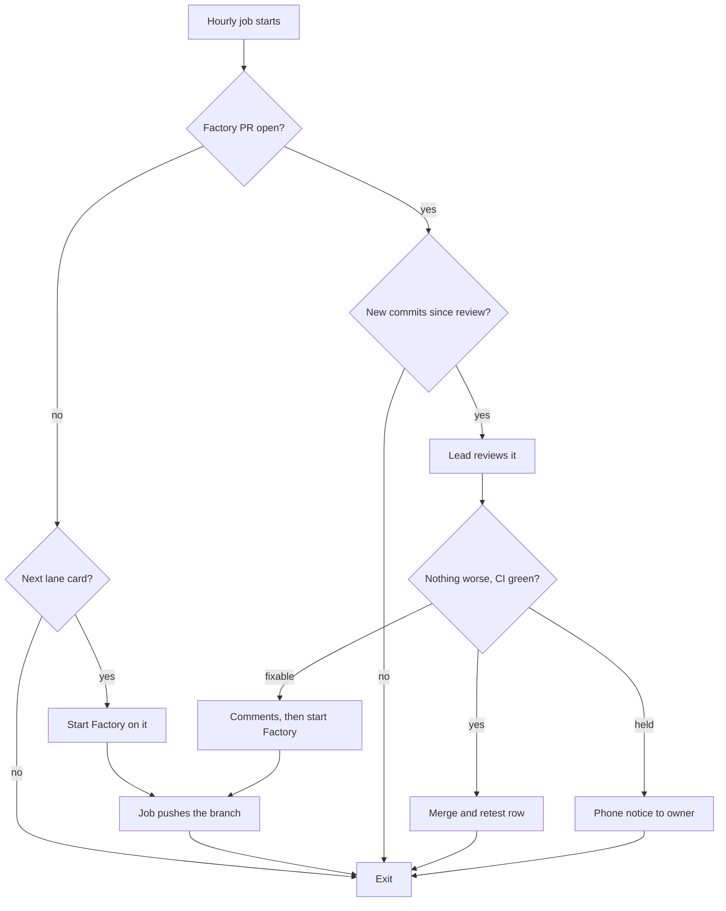

# Factory review loop

How Factory's pull requests get reviewed, fixed and merged without the product owner carrying messages between Factory and the lead. Proposed on 2026-10-16 at the owner's request and approved item by item the same day (`DECISIONS.md`, 2026-10-16, "The Factory review loop is approved item by item"). It was built for `.claude/skills/factory-loop/`: the hourly script `factory_loop.py`, the review procedure `SKILL.md` and the launch agent template. That folder is not in the repository while the loop is paused (below). Nothing runs until the owner installs it ([Install](#install)).

PAUSED on 2026-10-16 at the owner's call: not merged and not installed. The built code, its tests and its report are saved as `testing/Developer/reports/2026-10-16_factory_loop/paused_build.patch` and `build.md`. Two changes were agreed before pausing and are not in the patch: the loop runs only when the owner says go, for one named card, and stops when that card merges or needs the owner (no hourly schedule); and the review may merge its own docs branch, a one-line rule the owner adds by hand, since an agent may not widen its own permissions. To resume: apply the patch on a branch, make both changes, and run the review loop on it.

Last updated: 2026-10-17.

## Table of contents

- [The problem](#the-problem)
- [The loop](#the-loop)
- [What each part may and may never do](#what-each-part-may-and-may-never-do)
- [When it stops and tells the owner](#when-it-stops-and-tells-the-owner)
- [What needs your yes](#what-needs-your-yes)
- [How we test it first](#how-we-test-it-first)
- [Install](#install)
- [How to switch it off](#how-to-switch-it-off)

## The problem

Today one card takes this path, and the owner carries every arrow marked "owner":

1. Factory opens a pull request and tells the owner.
2. The owner tells the lead.
3. The lead's reviewers comment on the pull request.
4. The owner tells Factory to read the comments.
5. Factory pushes fixes and tells the owner, and steps 2 to 4 repeat.

Factory cannot see review comments by itself (owner, 2026-10-16), and the lead and Factory cannot message each other. So the owner is the messenger, both ways, for every round.

## The loop

A scheduled job on the owner's Mac runs once an hour while the Mac is awake. It does one thing per run, in this order, then exits:



In words:

- Start: when no Factory pull request is open, the job starts Factory on the next card in its lane (`docs/build/Factory_onboarding.md`, "How you work here"), in its own worktree. Factory builds, tests and commits; the job pushes the branch and opens the pull request from the body Factory wrote.
- Review: when a Factory pull request has commits the lead has not reviewed, the job runs the lead's review exactly as today: Factory's tests run, each part of the fix is removed in turn to check a test turns red, and for a behaviour change a judge, an adversary and, after the one fix round, a fresh verifier.
- Fix: findings go on the pull request as review comments, and the job starts Factory on them with a prompt that points at those comments. Factory commits; the job pushes.
- Merge: when CI is green and the fresh verifier finds nothing worse than develop, the job merges, removes the worktree and branch, and adds the card's row to `testing/Retest_product_owner.md` through a small docs pull request.

## What each part may and may never do

| Part | May | May never |
|---|---|---|
| The job's script | List and read pull requests; push branches named `factory/...`; open a Factory pull request from Factory's own body file; start the lead's review and Factory; send one phone notice | Push any other branch; force-push; touch `develop` or `production` directly; store a key anywhere in the repository |
| The lead's review run | Read the code; run tests, probes and gates in its own worktrees; post review comments; merge the one `factory/...` pull request it reviewed into `develop` when the conditions above hold; open the docs pull request for the retest row, which the lead or the owner merges | Merge anything that adds a migration, a dependency, or a change under `.claude/`, hooks, settings, auth or the graph credential; deploy to production; write to the knowledge graph; merge without the fresh verifier's PASS |
| Factory | Edit files inside its lane's fence, run its tests and builds, commit, in its own worktree (`droid exec --auto medium`) | Push, reach GitHub, deploy, run a migration (Factory's `--auto medium` level blocks remote writes; the job does the push) |

Limits, so a stuck loop cannot run up cost:

- One Factory pull request at a time.
- At most six runs a day and $3 of review spend a day; the job stops for the day at either.
- One fix round per card, as the review rules say. A second failure is a hold, never a third round.

## When it stops and tells the owner

One phone notice, under 200 characters, only for something the owner must act on:

- Factory's pull request body lists a question for the product owner.
- The fresh verifier holds a card: the notice names the two options the review rules allow, merge with the item named open, or close and re-split.
- The pull request touches anything the job may never merge.
- The day's run or spend limit is reached with work still waiting.

Everything else, start, review, fix, merge and the retest row, happens without a message.

## What needs your yes

The job is part of the security layer, so each item is a separate yes or no. Each item below was answered yes on 2026-10-16 (`DECISIONS.md`, "The Factory review loop is approved item by item"). Nothing is installed until the owner follows [Install](#install).

1. A scheduled job in the Mac's user launch agents folder, outside the repository, running the script hourly while the Mac is awake.
2. The script, committed under `.claude/skills/factory-loop/` through its own pull request, since it sits under `.claude/`.
3. The lead's review run in print mode with an allowed-tools list instead of permission prompts: reading files; `git` without push to `develop` or `production` and without force; `gh pr` list, view, diff, checks, review and merge, the merge limited by the script to `factory/...` heads; the test, lint and build commands of `/ship` Step 0; its own reviewer agents. No permission bypass flag.
4. Factory run headless at `droid exec --auto medium`, which can edit, test and commit but cannot push or reach GitHub.
5. Factory's key, `FACTORY_API_KEY`, kept in the Mac's keychain and read by the script at run time, never written to the repository, a log or a prompt.
6. The job pushes `factory/...` branches itself, and only those.
7. The limits above: one pull request at a time, six runs and $3 of review spend a day, one fix round per card.

## How we test it first

1. Run the script by hand once on card 100 with the schedule off, and watch each step.
2. Leave one deliberate gap in a test, to check the review comments, Factory picks them up, and the fix round closes it.
3. Turn the schedule on for card 106 only.
4. Widen to the whole lane after one card merges with no owner message.

## Install

The owner runs these, once, from the main checkout's root, `<repo-root>`. The loop's state, its logs and its prompt files live in `~/.factory-loop/`, outside the repository, and Factory's worktrees in `<worktree-root>/`.

1. Make the two folders: `mkdir -p ~/.factory-loop/logs <worktree-root>`. The launch agent cannot write its log into a folder that does not exist.
2. Put Factory's key in the keychain. With `-w` last and no value, the command asks for the key, so it never lands in the shell history:

   ```bash
   security add-generic-password -s factory-loop -a FACTORY_API_KEY -w
   ```

3. Find the folders of git, gh, the lead's command-line agent and Factory's headless command with `command -v`, and check each is in the template's `PATH` line. Add a missing folder to the copy in the next step.
4. Copy the template with its placeholders filled:

   ```bash
   sed -e "s|<repo-root>|$PWD|g" -e "s|<user>|$USER|g" \
     .claude/skills/factory-loop/com.factory-loop.plist.template \
     > ~/Library/LaunchAgents/com.factory-loop.plist
   ```

5. Run one pass by hand first, with the schedule still off, as [How we test it first](#how-we-test-it-first) says. `--dry-run` runs only the read commands, then stops at the first one that would change anything and prints what it would have run:

   ```bash
   venv/bin/python .claude/skills/factory-loop/factory_loop.py --dry-run
   venv/bin/python .claude/skills/factory-loop/factory_loop.py
   ```

6. Turn the schedule on: `launchctl load ~/Library/LaunchAgents/com.factory-loop.plist`. It runs once an hour while the Mac is awake, never at load.

What to read afterwards:

| What | Where |
|---|---|
| Every command each run took, one line each, the key never among them | `~/.factory-loop/logs/factory_loop.log` |
| The day's runs and review spend, each card's fix rounds, the head each review saw | `~/.factory-loop/state.json` |
| Each review run's full output | `~/.factory-loop/logs/review_pr<N>_<commit>.json` |
| What the launch agent itself printed | `~/.factory-loop/logs/launchd.out.log` and `launchd.err.log` |

## How to switch it off

- For now: `launchctl unload ~/Library/LaunchAgents/com.factory-loop.plist`. A run already going finishes its one action and exits.
- For good: unload it as above, then delete `~/Library/LaunchAgents/com.factory-loop.plist` and the key, `security delete-generic-password -s factory-loop -a FACTORY_API_KEY`.
- After card 106: the loop moves on to the next card in the order line by itself, so unload it after card 106 merges until the owner widens it to the whole lane, step 4 of [How we test it first](#how-we-test-it-first).
- Nothing else needs undoing. The loop leaves no branch but `factory/...` ones and the `chore/factory-done-<N>` branches of open docs pull requests, and `~/.factory-loop/` can stay as a record.
