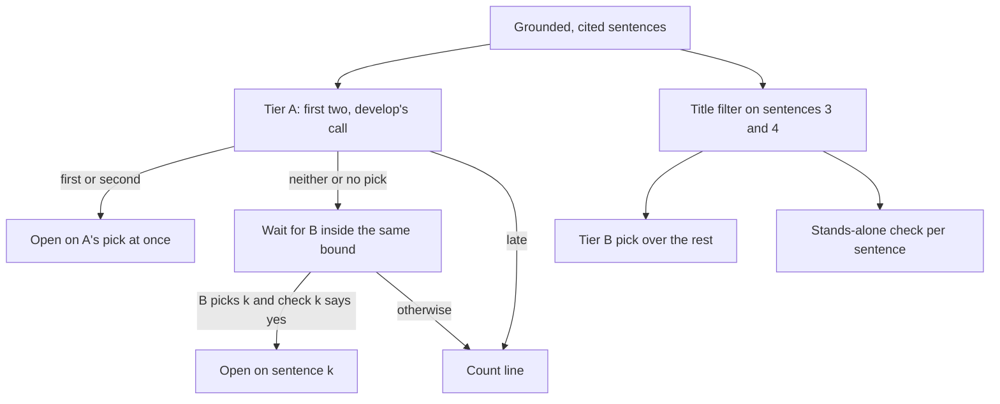

# Card 110: design for the opening sentence, second attempt

Design only; no source file changed. Worktree `asu-wt/card110`, branch `fix/card110-first-sentence-redesign`, at develop 7626fe85, which carries card 111's left-out rule (pull request #234). The first attempt lives on branch `fix/cards110-111-summary-opening` (closed unmerged, reference only) with its reviews in [2026-10-15_cards110_111](../2026-10-15_cards110_111/). The owner's words for the card: "When one of the first few cited summary sentences answers my question, the answer opens on that sentence, not on a line counting records; it never opens on a paper title or on a sentence that needs the one before it."

Everything measured here ran offline against the reviews' saved groundings, plus 60 live Jev calls (about $0.0015), with develop's own code in the worktree. Probe scripts: `<scratchpad>/d110/tiers_probe.py` (no model calls), `tierb_live.py` and `check_live.py` (live Jev).

## Table of contents

- [Why the first design failed](#why-the-first-design-failed)
- [Three designs weighed](#three-designs-weighed)
- [The recommended design](#the-recommended-design)
- [What a person sees, case by case](#what-a-person-sees-case-by-case)
- [The replay bench](#the-replay-bench)
- [Build steps, fences, tests and live check](#build-steps-fences-tests-and-live-check)
- [Latency](#latency)
- [What this design leaves alone](#what-this-design-leaves-alone)

## Why the first design failed

The first design (409a0610, then the fix round 3cef7ae6) made one pick over four candidates in one state, and the fix round added a stands-alone check on every pick after the first. Each finding traces to one of five mechanisms.

| Finding | What a person saw | Mechanism |
|---|---|---|
| A-110-01, A-110-04 | "Changes in this gene ...", "One is ...", "These include ..." opened the answer in bold from third or fourth place | M1: the one pick judges "answers the question", and a pointer sentence can answer. Its "neither" clause ("needs an earlier sentence") competes inside the same choice and loses. Confirmed today: develop's pick asked over only the later sentences chose "Changes in this gene" 5 of 5 and "One is ..." 5 of 5 (`tierb_live.py`). Only a separate yes-or-no question about the sentence alone blocks them (the fix round's check: 15 of 15 count line; today 20 of 20 `needs_earlier` on those four shapes plus "They include"). |
| V-110-02, V-110-05 | Query 66 with the features sentence second, develop's own win, opened on the count line about 1 time in 30 | M2: the fix round applied the stands-alone check to picks develop already made ("second"). On the features sentence the check says `stands_alone` 29 of 30 (verifier), 4 of 5 today. A check added on a path that was already right can only subtract from it. |
| V-110-03, A-110-02 | "Which diseases are associated with BRCA1?" opened in bold on "Preneoplastic stromal cells promote BRCA1-mediated breast tumorigenesis", a paper's title, 5 of 5, where develop opened on the count line | M3: the stands-alone check was asked the wrong question for a title. A title names everything it talks about, so it passes. Card 111's narrowed rule no longer drops a single title, so the third slot reached it. Whether a sentence IS a cited record's own title is structure, not meaning, and code can tell it: card 111's label machinery flags both titles of that case and no answering sentence in 28 saved runs and 7 hand cases (`tiers_probe.py`). |
| A-110-05, J-110-01, J-110-02, A-110-01 addendum | A long candidate cut at 700 characters; confidences shifting on develop's own candidates once four were in the state | M4: widening the one pick's state changed the decision develop was making. With four sentences and a smaller cap, develop's wins were no longer the same call, so "nothing worse than develop" had to be re-proved by sampling instead of holding by construction. |
| V-111-01 | A sentence develop never offered (the writer's third cited sentence, when a repeated title sits first or second) can open the answer with no check | M5: card 111's left-out filter runs before the cut to two, so the window slides. Minor today (no repeated title near the top in 38 live runs), and DECISIONS.md 2026-10-15 says this design settles which sentences the opening may come from. |
| V-110-01, V-110-04 | Nothing yet; two properties unguarded | Coverage: the fake Jev gave every check the same answer, and the late-check test used an instant pick, so matching a check to the wrong candidate and giving the check a fresh second both stayed green. |

## Three designs weighed

All three keep the rule that decisions go to a classifier and code only verifies, and all three use card 111's label machinery for the structural title test.

| | Design 1: one pick over four, title filter, check on picks after the first | Design 2: a later pick must beat develop's pick | Design 3: develop's pick untouched; a separate later path only when it says "neither" |
|---|---|---|---|
| Features third (the gain) | yes | yes | yes |
| Features second, develop's win | at risk: the check runs on pick "second" (M2), unless the check is limited to sentences beyond develop's window, and the four-sentence state still changes develop's call (M4) | kept only if "beat" is read as "develop's pick stands whenever it is a sentence"; then this is design 3 | kept by construction: the same call, the same state, returned at once |
| BRCA1 title third | count line (filter) | count line (filter) | count line (filter) |
| "One is", "These include", "Changes in this gene" third or fourth | count line (check) | count line (check) | count line (check) |
| Calls per answer (Jev) | 1 pick + up to 3 checks | 1 pick + 1 comparison + checks, the comparison serial after the pick | 2 picks + up to 2 checks, all started together |
| Critical path | one pick, then one check | pick, then comparison, then check: three serial calls, near the 1 s bound | max(pick A, pick B then check B); pick A alone when it picks |
| Proof that develop's wins are kept | by sampling | by sampling | by construction, plus sampling |
| Complexity | one function grows | a new decision point and prompt for "which opens better", a third kind of judgement to tune | two decisions that already exist, run side by side |

Design 2 only helps when develop's pick is "neither", and then there is nothing to beat; when develop's pick is a sentence it is already what the card asks for. So design 2 is design 3 with an extra serial call, and improving on develop's own picks (A-110-06, J-110-03) is a different card. Design 1 is the first attempt plus a filter, and M2 and M4 remain unless the check is limited to the later sentences, at which point it is design 3 in one function.

Recommended: design 3.

## The recommended design

In the user's words: if one of the first two cited sentences already answers, nothing changes. If neither does, the answer may open on the third or fourth cited sentence, but only when that sentence is not a record's own title and can be read without the sentences before it. Otherwise the count line opens, as today.

Pieces:

| Piece | What it is | Where it comes from |
|---|---|---|
| Tier A candidates | The first two cited sentences of the writer's prose, minus any card 111 leaves out. Slice first, then filter, so a sentence develop (before card 111) never offered is never in tier A. | `_lead_candidates` as on develop, with the order of slice and filter swapped (the verifier's V-111-01 mutation, which every test passes). |
| Tier A decision | Develop's `write.lead_sentence` call, unchanged: same options, criteria, instructions, `lead_sentence_state`, 1200-character cap. | `harness/decide.py`, untouched. |
| Tier B candidates | Cited sentences after the raw first two, not left out by card 111, up to two of them, minus any that repeats one label (below). A sentence that slid out of tier A because of card 111 lands here. | New `_later_lead_candidates(model_grounding, skip, label_by_display)` beside `_lead_candidates`. |
| The title filter | Structural: the sentence splits at its markers; every piece, after the grounding pass's own glue rule and end punctuation, equals the title or name of the record its marker cites, one label throughout, one or more markers, no trailing text. This is card 111's `_is_label_only_sentence` without the two-record and listing tests. A list of different names is not matched (it can be the answer to "which"); a title that states a finding is matched (it is still a record's own title, which the card says never opens the answer). | `_repeats_one_label`, factored out of `_is_label_only_sentence`, which then calls it and adds its two tests. Card 111's behaviour does not change. |
| Tier B decision | The same lead instructions and criteria, over the question and the tier B sentences labelled "Sentence 1" and "Sentence 2", under its own point name so the trace tells the two apart. | `LEAD_LATER_POINT = "write.lead_later_sentence"` in `decide.py`; state built by `lead_sentence_state`. |
| The stands-alone check | The fix round's `write.lead_stands_alone` decision, one per tier B candidate, with the reworded criterion ("or is given by the sentence itself, such as a list it goes on to state"). The sentence alone, markers removed, no question. | Copied from the old branch's `decide.py` (`git show fix/cards110-111-summary-opening:src/system_03_search_agent/harness/decide.py`): `LEAD_STANDALONE_POINT`, the two options, instructions, criteria, `lead_standalone_criteria`, `lead_standalone_state`, `_STANDALONE_SENTENCE_MAX_CHARS`. |
| Timing | All tasks start together. Wait for A within `wait_s = min(1.0, budget_s - 0.5)`. A picks: return at once and cancel the rest. A says "neither" or has no usable pick: wait for B within what is left of the same `wait_s`; B picks k: wait for check k within what is left; `stands_alone` returns k, anything else returns None. A late: return None without reading B. Every task is cancelled and gathered in `finally`. | `_lead_sentence_choice`, the one function that changes in `core/graph.py` beyond the two candidate helpers. |

Fail-closed paths, all returning None (the count line):

| Path | Result |
|---|---|
| No tier A candidate and no tier B candidate, budget under 1.5 s, or the guard tier is the classifier | not asked, as on develop |
| Tier A late (past `wait_s`) | count line; B is not read even if it finished |
| Tier A "neither", tier B empty | count line |
| Tier A "neither", tier B late, "neither" or no usable pick | count line |
| Tier B picks k, check k late, `needs_earlier`, failed seam or no usable answer | count line |
| Tier A has no candidate but tier B has (only when card 111 left out both of the raw first two) | B runs alone, with its checks |

What stays exactly develop's: `LEAD_SENTENCE_PICKS` (two), `MAX_LEAD_CANDIDATES`, `_LEAD_CANDIDATE_MAX_CHARS` 1200, `_LEAD_DECISION_MAX_WAIT_S` 1.0, `_LEAD_DECISION_MIN_BUDGET_S` 1.5, `_answer_parts`, the features directive, the listing, every card 111 test.

No hardcoded decisions: the title filter compares a sentence with the cited record's own label field (`answer_layout.LABEL_FIELDS`), no word list of its own; the only borrowed list is the grounding pass's glue rule (`_clean_claim`), as card 111 already borrows it. The two classifier texts name no question, no test word and no pointer word; the verifier's scan of the stands-alone text (Marfan, BRCA1, disease, gene, MedGen, These, One is, Another, They: none present) should be repeated on the copied text.

The one deliberate departure from develop 7626fe85 is V-111-01: when card 111 leaves out one of the raw first two cited sentences, develop offers the writer's third cited sentence in its window with no check, and this design offers it through tier B with the filter and the check. In the card's words, a sentence that could not open the answer before today opens it only after both tests. It needs a repeated title among the first two cited sentences, which no live run in 38 has produced, and in the card 111 verifier's probe c18 the third sentence answers on its own, so a person loses nothing there.

## What a person sees, case by case

Evidence: the reviews' replays and today's probes (`tierb_live.py`: develop's pick over only the tier B sentences, 5 runs each; `check_live.py`: the stands-alone check, 5 runs each).

| Case | Grounding | Develop 7626fe85 | This design | Why |
|---|---|---|---|---|
| Features first or second (develop's win) | adv d66_1, d66_3, d66_4; ver d66_2 (second, the V-110-02 grounding) | features | features | tier A is the same call, returned at once; no check runs on it |
| Features third (the gain) | adv d66_5; ver d66_1; fix round f66_2 | count line 5 of 5 (adv replay) | features: tier B pick "first" 5 of 5 today on both groundings; check `stands_alone` 4 of 5 today, 29 of 30 (verifier) | A says "neither", B picks it, the check passes it most of the time |
| Features fifth | adv d66_2 | count line | count line: tier B is S3 and S4, pick "neither" 5 of 5 today | A-110-03, out of this card's "first few" |
| "Which diseases ..." answered third | case V_good3 | count line 5 of 5 | opens on "Diseases linked to BRCA1 include ...": pick 5 of 5, check 5 of 5 today | the control case |
| BRCA1 title third (V-110-03) | case A110_02 | count line 5 of 5 | count line, by construction: S2 and S3 are flagged as a record's own title (`tiers_probe.py`), so tier B is empty | M3 |
| "Changes in this gene ..." third | case A110_01; adv bbrca_2, dbrca_1 S3 | count line (adv replay 3 of 3) | count line: check `needs_earlier` 5 of 5 on both groundings today | M1 |
| "One is ..." third, "Another is ..." fourth | case A110_04a; fix round fbrca_4 (live) | count line 2 of 2 | count line: check `needs_earlier` 5 of 5 today | M1 |
| "These include ..." fourth | case A110_04b | count line | count line: check `needs_earlier` 5 of 5 today | M1 |
| "They include ..." second | case V_they2 | opens on it 5 of 5 (verifier) | opens on it, the same | tier A is develop's; see the last section |
| "A third trial ..." first at confidence 0.04 | adv dtrial_1 | opens on it | opens on it, the same | A-110-06, older than this card |
| Repeated title first, answer third (V-111-01) | card 111 verifier c18 | opens on the third sentence, no check | opens on it when the check says it stands alone, else the count line | the departure named above |

## The replay bench

Every saved grounding from the 2026-10-15 reviews. All sit in this session's scratchpad directory, the same one the reviews used; the paths below are relative to it. Each is replayed through `_lead_sentence_choice` with live Jev on both trees, 5 times, as `vprobes/vreplay.py` does (a `GroundingResult` built from the saved sentences, `CLASSIFIER_PROVIDER=jev`, budget 40 s, the `.env` of the main checkout with the database and Redis variables unset). The title filter needs the label map (display number to the cited record's name or title); the bench computes it from the saved `_answer_parts.pkl` kwargs (`citations` and `synth_findings`) where there is one, and passes an empty map otherwise, which is safe because no saved sentence outside case A110_02 is a bare label (`tiers_probe.py` over all 28 kwargs; the fix round's and verifier's rows read by eye: "Is associated with PMID 37058316." is not a label).

| Source | File | Groundings | Fields | Notes |
|---|---|---|---|---|
| Adversary live runs | `out/<tag>.json` and `out/<tag>_answer_parts.pkl` | 28: b66_1 to 5, d66_1 to 5, bbrca_1 to 5, dbrca_1 to 5, bgene_1 and 2, dgene_1 and 2, btrial_1 and 2, dtrial_1 and 2 | `question`, `grounded_sentences`; the pickle holds `model_grounding`, `citations`, `synth_findings` | the pickles are this session's own artifacts |
| Adversary offline cases, as the verifier saved them | `vprobes/case_A110_01.json`, `case_A110_02.json`, `case_A110_04a.json`, `case_A110_04b.json` | 4 | a list of sentences; question "Which diseases are associated with BRCA1?" | markers are dbrca_1's display numbers, so the label map is dbrca_1's |
| Verifier's own cases | `vprobes/case_V_good2.json`, `case_V_good3.json`, `case_V_they2.json` | 3 | as above | same label map |
| Fix round live runs | `fx1/<tag>.json` | 10: f66_1 to 5, fbrca_1 to 5 | `sentences`, `summary_claims`; the JSON line follows litellm banner lines, so read the last line that starts with `{` | question by tag prefix |
| Verifier live runs | `vprobes/live.jsonl` | 21 rows (b66_2 has no sentences and is skipped) | `tag`, `tree`, `question`, `sentences` | d66_1 is the features-third gain, d66_2 the features-second win |
| Card 111 verifier's fake-writer cases | `vprobes/test_zz_v111_probe.py`, cases c18, c19, c24, c25 | 4 | unit shapes, run with a fake seam, not live | V-111-01 |

That is 66 live groundings and 4 unit shapes. For each live grounding the bench records, per replay: which sentence opened (or the count line), tier A's record, tier B's record, each check's answer matched to its sentence, and wall time of `_lead_sentence_choice`.

The bar, all four parts:

1. No lost win. For every grounding, the design's count of replays that open on a sentence is at least develop's count minus Jev's own noise, and, by the records, every replay in which tier A picked opened on that pick. On ver d66_2 and adv d66_3 and d66_4 (features second) the design opens on the features 10 of 10, as develop does.
2. No forbidden opening. Across every replay on the design, zero openings on a flagged title (case A110_02 S2 and S3: assert they are never tier B candidates) and zero openings on A110_01 S3, A110_04a S3 and S4, A110_04b S4, adv bbrca_2 S3, dbrca_1 S3, dbrca_4 S3, fix round fbrca_4 S3 and S4, or any other sentence that sits beyond tier A and whose check said `needs_earlier`.
3. The gain. On adv d66_5, ver d66_1, fix round f66_2 and case V_good3 the design opens on the answering sentence in at least 4 of 5 replays, where develop opens on the count line 5 of 5.
4. Latency. Every replay returns within 1.0 s on both trees; the medians are reported side by side.

Cost: 66 groundings, 5 replays, 2 trees, up to 4 Jev calls each at about $0.00002, about $0.06.

## Build steps, fences, tests and live check

Order, one commit per step where it reads cleanly:

| Step | File | Change |
|---|---|---|
| 1 | `src/system_03_search_agent/harness/decide.py` | Add `LEAD_LATER_POINT`. Copy the stands-alone block from the old branch: `LEAD_STANDALONE_POINT`, `LEAD_STANDS_ALONE`, `LEAD_NEEDS_EARLIER`, `LEAD_STANDALONE_OPTIONS`, `LEAD_STANDALONE_INSTRUCTIONS`, `_LEAD_STANDALONE_CRITERIA` (the reworded one), `lead_standalone_criteria`, `lead_standalone_state`, `_STANDALONE_SENTENCE_MAX_CHARS`. Nothing else in the file moves: picks stay two, the cap stays 1200, `lead_sentence_state` is untouched. |
| 2 | `src/system_03_search_agent/core/graph.py` | `_repeats_one_label(sentence, label_by_display)` factored out of `_is_label_only_sentence`; `_is_label_only_sentence` becomes the two-record test, the listing test and that call, so card 111's tests stay green unchanged. `_lead_label_map(citations, synth_findings)` factored out of `_label_only_positions`. |
| 3 | `core/graph.py` | `_lead_candidates`: slice the first two cited sentences, then drop `skip`. New `_later_lead_candidates`: cited sentences after the raw first two, not in `skip`, not `_repeats_one_label`, the first two of them. |
| 4 | `core/graph.py` | `_lead_sentence_choice` gains `label_by_display`, builds tier B's spec and the check specs, starts every task together, and follows the timing table above. The call site in `_write_answer` passes the label map (built once and shared with `_label_only_positions`). |
| 5 | tests | below |
| 6 | `DECISIONS.md` | one row: the design, the two alternatives, the why (develop's call kept by construction; the title is structure; the pointer sentence is a classifier question of its own). |
| 7 | `testing/UI_fix_plan.md` | card 110's row points at this folder. |

Fences: no change to `_answer_parts`, `synthesis/findings.py`, `synthesis/answer_layout.py`, the listing, the frontend, `harness/tiers.py` (the glm price line stays scratch-only, as every review noted), or any card 111 test. `_is_label_only_sentence` keeps its exact behaviour: run `tests/system_03_search_agent/core/test_summary_label_only_sentence.py` before and after step 2.

Tests, each named for what it pins, in `tests/system_03_search_agent/core/test_write_answers_sooner.py` unless said otherwise, using the file's fake Jev and `_decide_point` seam:

| Test | Pins | Mutation that must turn it red |
|---|---|---|
| test_the_third_cited_sentence_leads_when_the_first_two_do_not_and_it_stands_alone | the gain | tier B never built |
| test_a_later_sentence_that_needs_an_earlier_one_leaves_the_count_line_leading | M1 | check answer ignored |
| test_a_record_title_is_never_a_later_candidate_but_a_list_of_names_is | M3 | `_repeats_one_label` returns False always; or the two-record test left in |
| test_a_first_or_second_pick_returns_at_once_and_never_waits_for_the_later_path | M2, V-110-05 | a hung tier B task; the test fails if the result waits on it |
| test_each_check_is_read_for_its_own_sentence | V-110-01 | fake seam keyed by sentence text, answers out of finish order; mutate to `checks[0]` |
| test_the_pick_and_the_check_share_one_bound | V-110-04 | A "neither" at 0.5 s, B at 0.6 s, check k at 1.05 s: None, elapsed at most 1.0; mutate `left_s = wait_s` |
| test_a_late_first_pick_leaves_the_count_line_without_reading_the_later_path | timing table | B finished early with a pick; A late; result None |
| test_tier_a_never_holds_a_sentence_beyond_the_raw_first_two | V-111-01 | filter-then-slice restored |
| test_a_sentence_that_slid_out_of_the_first_two_is_offered_only_through_the_later_path | V-111-01 | same |
| test_every_started_task_is_done_or_cancelled_on_return | hygiene | `finally` removed |
| `harness/test_decide.py`: test_the_later_point_and_the_standalone_texts_name_no_question_word; test_the_standalone_state_is_the_sentence_alone_and_bounded | no hardcoded decisions | texts edited |

Also run the old branch's `test_decide.py` standalone tests as a source (`git show fix/cards110-111-summary-opening:tests/system_03_search_agent/harness/test_decide.py`), copying only the standalone ones.

Gates, as the reviews ran them: `ruff check` with no path from the worktree root; `isort --check-only` on the touched files (`core/graph.py` fails identically on develop, the `EventResolvedEntity` block); `pytest tests/system_03_search_agent/harness tests/system_03_search_agent/core tests/system_03_search_agent/synthesis -m "not integration" -q` (the two `test_opus_writer.py` glm price failures are develop's).

Live check, after the bench: five runs each of query 66 ("What phenotypic features are associated with Marfan syndrome?") and "Which diseases are associated with BRCA1?" in Plain language on both trees, with the reviews' setup (`core/run.py` `run_streaming`, `reads_placement=True`, `CLASSIFIER_PROVIDER=jev`, `PER_QUERY_COST_CAP_USD=0.25`, `SYNTH_MODEL=z-ai/glm-5.2` with the scratch-only price line, guard and plan `deepseek/deepseek-v4-flash`, interaction capture and session memory stubbed, `USER_DB_URL` and `REDIS_URL` unset). Table columns: run, tree, opens on, grounded sentences in order, tier A record, tier B record, checks by sentence, lead ms, cost. Save every run's grounding and kwargs to the scratchpad and add them to the bench, so the next review inherits them. The features-third shape appeared in 2 of 10 develop runs across the reviews, so the live check may not show the gain; the bench is the proof of the gain, the live check is the proof of no regression and of latency in the whole answer. Budget about $0.40.

## Latency

The bound is F-8.7-A07's: `wait_s = min(1.0, budget_s - 0.5)` for the whole of `_lead_sentence_choice`, unchanged.

| Path | Develop | This design |
|---|---|---|
| Tier A picks (every develop win) | one call, 160 to 470 ms live across the reviews | the same call, returned the moment it lands; B and the checks are cancelled. The fix round measured a pick beside parallel checks at 212 ms against 223 ms alone (`vlat.py`, 15 each): no drag. |
| Tier A "neither" | one call, then the count line | max(A, B) then check k, all started at the same instant: B's pick 155 to 385 ms today, the check 185 to 460 ms with one 913 and one 1389 ms outlier. Typical total 300 to 500 ms; the outliers hit the bound and give the count line, as a slow Jev does today. |
| Worst case | 1.0 s | 1.0 s, pinned by the shared-bound test |
| Jev calls per answer | 1 | up to 4 (A, B, two checks), 5 when a sentence slid out of tier A; about $0.00002 each |

The guard-tier fallback inside `_decide_point` (about 2 s) can only land after the bound, so it never leads, as today; the fix round's note that a failing Jev costs up to three extra guard calls applies here too, and they are cancelled at the bound.

## What this design leaves alone

- Tier A keeps develop's known weaknesses, on purpose: "They include ..." in second place opens the answer (verifier, 5 of 5 on develop), "A third trial ..." at confidence 0.04 opens it (A-110-06), and "It mainly affects ..." in second place does too (J-110-03). Each needs a check on develop's own picks, which is exactly what V-110-02 showed can only subtract from develop's wins. If the owner wants the card's "never" to reach tier A, that is its own decision with its own measured loss rate, not a clause in this build.
- The features sentence fifth or later stays on the count line (A-110-03); the card says "first few".
- The stands-alone check says `needs_earlier` to the features sentence about 1 time in 10 to 30 (verifier 1 of 30, today 1 of 5). It costs part of the gain and none of develop's wins. If the live check or the bench shows the gain under 4 of 5, the one lever is the check's criterion wording, measured as the fix round did (30 checks per sentence), never a word about the question.
- With the guard tier as the classifier (`CLASSIFIER_PROVIDER` default), nothing is asked and the count line leads, as on develop.
- A sentence that is a record's title but also the only answer the writer gave stays out of the opening; it still prints in the prose and the record sits in the listing.
