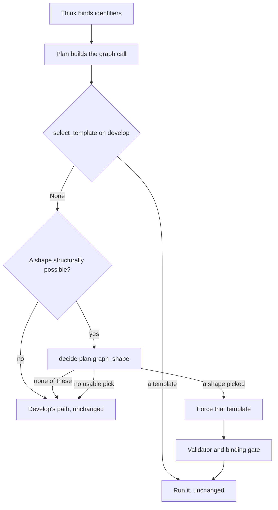

# Card 15 design: five checked graph searches, one question shape at a time

When no checked graph search fits a question, a model writes one, and about one run in ten the written search is malformed, times out, or answers a different question. The 8 October attempt closed that path with one rule for every shape and failed review. This document designs what the 8 October decision row says ends the park: the five checked templates the build note names, built one question shape at a time, each chosen by a classifier and never by a word list, with every other question left exactly as develop has it.

Written 2026-10-15 from develop at `7626fe85`, the parked code at `parked/card15-checked-searches-2026-10-08`, the 8 October build, judge and adversary reports, card 15's diagnosis, the `DECISIONS.md` rows naming the card, and `testing/Test_queries_and_workflows.md`. No source file was changed. Nineteen read-only queries were run against the live graph through `graph_connection.execute_cypher`, the helper the e2e test uses, with the reader credential; their timings are in the appendix and decide most of what follows.

## Table of contents

- [In one minute](#in-one-minute)
- [1. The five question shapes](#1-the-five-question-shapes)
- [2. How Plan chooses a template](#2-how-plan-chooses-a-template)
- [3. The build order](#3-the-build-order)
- [4. What review found wrong on 8 October, and how each is avoided](#4-what-review-found-wrong-on-8-october-and-how-each-is-avoided)
- [5. Risks: a confident wrong record](#5-risks-a-confident-wrong-record)
- [6. What a builder needs before starting](#6-what-a-builder-needs-before-starting)
- [Appendix: the read-only probes of 2026-10-15](#appendix-the-read-only-probes-of-2026-10-15)

## In one minute

- The five shapes, each a checked, parameterised, read-only Cypher template: the records of several named papers; whether a named paper mentions a named gene; the variants in several named genes linked to a named condition; the genes of a named Gene Ontology term; the papers tagged with a named MeSH term.
- Measured live today: the first three answer in 0.5 to 4.6 s. The two term shapes as the build note wrote them time out at 30 s or take 18 s, because an `ORDER BY` over every match forces a whole-table plan; a bounded form that takes the first hundred matches and sorts those answers in 0.7 s, and the design uses it with an honest "more than shown" flag.
- Plan asks one classifier decision, `plan.graph_shape`, only for a question develop's own template selection returns None for today and whose bound identifiers make one of the five shapes structurally possible. A pick forces that template through the existing `template=` seam. "None of these", or no usable pick, leaves the plan byte-identical to develop's. No question that has a template today is touched.
- One shape per commit, smallest first: papers' records, gene in a paper, genes' variants for a condition, GO term's genes, MeSH term's papers. Each commit carries its unit tests, a mutation check, a new test query entry, and a five-run live check beside develop.
- None of the 8 October failures can recur by construction: there is no record fallback, no declined-search state, no new word test, and every template returns the anchor the person typed or is anchored at both ends on typed identifiers.
- The owner is asked one thing: the two term shapes are reached only by a person who types a GO or MeSH identifier, which no test query does. A disease's variants from the disease end, which test queries 20, 66 and 81 reach, measured 1.0 to 1.4 s and could take their place.

## 1. The five question shapes

The build note of 8 October ("Paths kept and why") names five paths a checked template would need. Each is designed here with its example, its template, what it reads and returns, how its rows cite their source, and the test query that proves it.

An honest note on the examples first. The test queries document types none of these five shapes: every graph question in it already has a checked template on develop (queries 1, 2, 5, 7, 10, 12, 19 to 25, 64, 78, 79, 104), or reaches a path that is not one of the five (66, 68, 81, 87). The example under each shape is therefore the wording the 8 October reviewers probed with, quoted from `testing/Developer/reports/2026-10-08_card15/` and the diagnosis, and labelled as such. It is not a prompt string this design invented, and it is not a test query until the owner or the lead writes the entry (section 6).

Conventions shared by all five:

- Every id is a `$e_...` parameter from `cypher_query.entity_param_bindings`; no literal value ever enters the query.
- Every anchor is an inline `{id: $e}` match, the indexed form; no template uses `WHERE a.id IN [...]`, which the module measured as a whole-table scan (J-15-02).
- Every template passes `validate_cypher` and `_check_entity_binding` like a generated query, runs under the reader role and the statement timeout, and returns whole vertices so `cypher_provenance.to_output_rows` has `id`, `name` and `source_url`.
- Several branches are joined with `UNION ALL`, the form `_record_template` and `_article_links_template` already use; AGE rejects edge-label alternation, so a shape over several edges is several branches.

### Shape A: the records of several named papers

| Field | Design |
|---|---|
| Example on record | `Compare PMID 11237011 and PMID 11237012` (judge's probe, J-15-01) |
| What a person wants | Both papers, each cited, so they can compare them; never one paper and never a search that does not finish |
| Template | `article_record_many`, the existing `_record_template("Article", params)`: one `MATCH (a:Article {id: $e}) RETURN a ORDER BY a.id` per paper, joined by `UNION ALL`, branches in parameter-name order |
| Reads | `Article` vertices only, no edge |
| Returns | One row per named paper, or none for an id the graph lacks |
| Citation | Each row's own `source_url`, measured live: `https://pubmed.ncbi.nlm.nih.gov/<pmid>/` |
| Structural eligibility | Two to ten `PMID` identifiers bound and nothing else; develop's `select_template` returns None, which today means a hop or aggregate class (a lookup or exploratory class already takes the record) |
| Measured | 0.53 s for two papers |
| Proves it | New test query 110 (the number the diagnosis reserved for this card) |

### Shape B: whether a named paper mentions a named gene

| Field | Design |
|---|---|
| Example on record | `Does PMID 11237011 discuss BRCA1?` (diagnosis and judge) |
| What a person wants | A yes with the paper cited when the graph links them, and plain words when it does not; never "the paper does not discuss it", which the graph cannot assert |
| Template | `gene_article_link`: `MATCH (a:Gene {id: $e_gene})-[:mentioned_in]->(x:Article {id: $e_pmid}) RETURN x ORDER BY x.id`, the form `gene_disease_link` already uses with both ends inline |
| Reads | `Gene`, `mentioned_in`, `Article` (the pair `EDGE_ENDPOINTS` documents) |
| Returns | One Article row or none |
| Citation | The paper's `source_url`, the PubMed page |
| Structural eligibility | Exactly one `NCBIGene` and exactly one `PMID` bound, nothing else; a label mix develop declines today |
| Measured | 3.5 s for a linked pair, 3.1 s for an unlinked pair (the edge is walked from the gene end; BRCA1 has thousands of papers) |
| Proves it | New test query 112 |

An empty result is the graph's "no such link", not the paper's "no". Write's existing empty-graph wording plus the gene's live fan-out is what the person sees; the live check in section 3 reads the answer for any sentence that turns the absence into a denial.

### Shape C: the variants in several named genes linked to a named condition

| Field | Design |
|---|---|
| Example on record | `Variants in MLH1 and MSH2 causing Lynch syndrome` (diagnosis; `_mixed_gene_disease_template` returns None for the variants shape with several genes) |
| What a person wants | Each gene's linked variants side by side, each with the conditions its ClinVar record names, and a plain line when more exist than are shown |
| Template | `gene_variant_disease_link_many`: one branch per gene, in parameter-name order, joined by `UNION ALL`. Each branch is the existing `_gene_variant_disease_link_template` pattern with an equal share of the plan's 100 rows taken in variant-id order before the fold: `MATCH (v:SequenceVariant)-[:is_sequence_variant_of]->(a:Gene {id: $e_gene}) MATCH (v)-[:has_phenotype]->(x:Disease {id: $e_disease}) WITH v, collect(DISTINCT x) AS xs ORDER BY v.id LIMIT <share> RETURN v, xs ORDER BY v.id`, where `<share>` is 100 divided by the number of genes, a code constant per branch count, never caller text. Several conditions use the inline-or-IN clause the one-gene template already uses for its disease end |
| Reads | `SequenceVariant`, `is_sequence_variant_of`, `Gene`, `has_phenotype`, `Disease` |
| Returns | Variant rows, each carrying `clinvar_condition_ids` from the fold; the Disease vertices as their own rows, exactly as query 79's one-gene table |
| Citation | Each variant's ClinVar page; each condition's MedGen page; names resolved live as card 103 does, placeholders worded as card 103 words them |
| Structural eligibility | Two to ten `NCBIGene` and one to ten `Disease` (`MedGen`, `MONDO`) identifiers bound, nothing else |
| Measured | 4.6 s for two genes, 200 matches; 2.5 s for a second condition. Without the per-branch share, the first gene's hundred rows filled the cap and the second gene showed nothing, which is why the share exists |
| Proves it | New test query 113; query 24 is the nearest existing question and is unchanged (no variants word, so `gene_diseases_many` today and tomorrow) |

Truncation is honest for free: `_build_count_cypher` declines a `UNION`, so a capped result reports `truncated=True, total_available=None`, the "more than shown, total unknown" state Write already words.

### Shape D: the genes of a named Gene Ontology term

| Field | Design |
|---|---|
| Example on record | `Which genes take part in GO:0006281?` (build note, judge J-15-01, adversary) |
| What a person wants | The term named in words, then its genes each cited, and a plain line when the term has more genes than are shown |
| Template | `go_term_genes_one`, six `UNION ALL` branches, two per GO label (`BiologicalProcess` with `participates_in`, `MolecularActivity` with `actively_involved_in`, `CellularComponent` with `located_in`): the term's own record, `MATCH (a:<Label> {id: $e}) RETURN a ORDER BY a.id`, then its genes in the bounded form, `MATCH (x:Gene)-[:<edge>]->(a:<Label> {id: $e}) WITH x LIMIT 100 RETURN x ORDER BY x.id`. Only the label the id belongs to returns rows |
| Reads | The three GO labels, their three edges, `Gene` |
| Returns | The term vertex first (its `name`, "DNA repair" for the probed id), then up to 100 genes |
| Citation | Each gene's NCBI Gene page. The term row itself is uncited by rule: a GO vertex is cited only on a caller's explicit say-so (`cypher_provenance._go_attribution_curie`, review F-01), and here it is the anchor, not a finding |
| Structural eligibility | Exactly one `GO` identifier bound, nothing else. `anchor_label_for` returns None for it today, so develop writes the search |
| Measured | The build note's form, `RETURN x ORDER BY x.id`: 30 s timeout for GO:0006281, 18 s for a small term and for the count. The join itself: 0.7 s. The bounded form: 0.74 s for the large term, 0.67 s for the small one. The record branch: 0.42 s |
| Proves it | New test query 114 |

Why the bounded form is honest: the `WITH x LIMIT 100` is a scoping limit the validator already recognises (`_CLAUSE_CONTINUATION_KEYWORDS`, F-2.1-A8) and the live service accepted it; the `UNION` keeps the count rewrite off, so a term with more than a hundred genes reports `truncated=True` with the total unknown, and the answer says "the first 100 genes the graph lists" rather than claiming the set is complete. A term with fewer than a hundred genes returns them all, sorted by id, the same set every run. The one corner is a term with exactly 100 genes, reported as truncated though complete: it claims less, never more.

### Shape E: the papers tagged with a named MeSH term

| Field | Design |
|---|---|
| Example on record | `Which papers are tagged with MeSH D001943?` (judge J-15-01) |
| What a person wants | The term in words, then papers each cited, and a plain line when there are more |
| Template | `mesh_term_articles_one`, two `UNION ALL` branches: the term's record, `MATCH (a:OntologyClass {id: $e}) RETURN a ORDER BY a.id`, then `MATCH (x:Article)-[:has_mesh_annotation]->(a:OntologyClass {id: $e}) WITH x LIMIT 100 RETURN x ORDER BY x.id` |
| Reads | `OntologyClass`, `has_mesh_annotation`, `Article` |
| Returns | The term vertex, then up to 100 papers |
| Citation | Each paper's PubMed page; the term row cited to its NCBI MeSH page through `cypher_provenance`'s MeSH mapping. The graph names the term `[MeSH] D001943`; query 64's live name resolution turns that into words |
| Structural eligibility | Exactly one `MeSH` identifier bound, nothing else |
| Measured | The build note's form: timeout at 30 s for every term probed, the count too. The bounded form: 0.69 s. The record: 0.47 s |
| Proves it | New test query 115 |

### What the five cost a person in time

| Shape | Measured worst case | Against the 20 s answer guide |
|---|---|---|
| A, papers' records | 0.53 s | Well inside |
| B, gene in a paper | 3.5 s | Inside |
| C, genes' variants for a condition | 4.6 s | Inside |
| D, GO term's genes, bounded | About 3 s for six branches, each 0.4 to 0.7 s (the builder measures the joined form) | Inside |
| E, MeSH term's papers, bounded | 1.2 s for two branches | Inside |

## 2. How Plan chooses a template

The owner's rule: a decision point goes to a classifier model; code keeps structural facts, schema bounds and a fail-safe, and verifies. The 8 October build routed by Think's class and a count regex; this design routes by one decision through the seam every other decision in `core/graph.py` uses (`_DecisionSpec`, `_decide_point`, `_usable_choice`).

The decision, step by step:

1. Plan builds `_PlannedToolCall` exactly as today (`_select_planned_tool_call`, the `CypherQueryInput` with Think's identifiers, or the remembered antecedent).
2. Code calls develop's own `select_template(cypher_input, entity_param_bindings(target_entities))`. Anything but None: nothing changes, no decision is asked. This is the guarantee that no question with a checked search today is touched, and it costs no call.
3. Code computes which of the five shapes the bound identifiers make structurally possible, from their prefixes and counts only (the eligibility rows in section 1). Nothing possible: develop's path, no decision asked. Today's bindings make at most one shape possible for any set, so the decision is in practice two options.
4. Plan asks `decide(point="plan.graph_shape")` with the question text as the state, the possible shape names plus `none_of_these` as the options, `fail_open="none_of_these"`, bounded by Plan's step deadline through `_await_within_step` as `plan.paper_links` is. The decision is started after Think because it needs Think's identifiers; it runs in parallel with nothing else Plan waits on, and a guard-tier pick measured 0.3 to 1.5 s on this seam.
5. A usable pick naming a shape: the template is built from the bound parameter names and set on `_PlannedToolCall.template`, the `template=` seam `plan_node` already uses for the GO context call, with `context_only=False` so the rows are the answer's findings. `cypher_query` then runs the validator and the binding gate on it like every template.
6. `none_of_these`, or no usable pick (seam failure, timeout, cost cap): the planned call is byte-identical to develop's and runs develop's path.

The decision's description, code-authored, neutral, with no test question in it. Draft text for the builder, to be measured on held-out phrasings before merge:

| Option | When to choose it |
|---|---|
| `papers_named` | The question asks about, for a summary of, or to compare the named papers themselves |
| `gene_in_paper` | The question asks whether, or how, the named paper discusses, mentions, studies or reports on the named gene |
| `genes_variants_for_condition` | The question asks which variants, mutations or alleles in the named genes are linked to, cause, or are reported for the named condition, where the condition is named as a condition and not as a sample type or a passing word |
| `term_genes` | The question asks which genes take part in, carry out, are involved in, or are located in the named Gene Ontology term |
| `term_papers` | The question asks which papers, articles or publications are tagged with, indexed under, or about the named MeSH term |
| `none_of_these` | Anything else: it asks for a number or a count, for something linked to the named records other than what the option names, what a named record is, or for something the graph does not hold such as prevalence, treatment or trials |

What this design does not do to develop:

- `select_template`'s existing keyword tests are not extended and not removed; the five shapes add no word to code.
- `written_search_allowed`, `_record_fallback` and `NO_CHECKED_SEARCH_MESSAGE` from the parked branch are not brought back. There is no declined-search state.
- `_LABEL_BY_PREFIX` keeps Gene, Disease and Article. The five templates are built by name from the bound parameters, so `anchor_label_for` is untouched and no new label enters develop's own selection.
- `core/graph.py` gains one `_DecisionSpec`, one eligibility function, and one branch in `plan_node` after the planned call is built. `_MAX_DONE_DECISIONS` is 16; a run makes at most seven decisions after this.

## 3. The build order

One shape per commit, smallest first. Every commit is independently revertible: reverting it removes one option and one template, and the questions it served return to develop's path.

Common to every commit:

- File fence: `src/system_03_search_agent/tools/cypher_templates.py` (the template and its entry in `all_template_examples`), `src/system_03_search_agent/core/graph.py` (the first commit adds the decision spec, the eligibility function and the `plan_node` branch; later commits add one option and one eligibility row), `tests/system_03_search_agent/tools/test_cypher_templates.py`, `tests/system_03_search_agent/tools/test_cypher_query_templates.py`, the core plan tests beside the `plan.paper_links` ones, `testing/Test_queries_and_workflows.md` (one entry), `DECISIONS.md` (one row). Not touched: `cypher_query.py`'s pipeline, `cypher_validator.py`, `graph_connection.py`, `synthesis/`, the frontend.
- Tests on every commit: the template builds, passes `validate_cypher` with its `ORDER BY` before the injected cap, binds only its parameter names, and is in the example set; through the pipeline with the fake `execute_cypher`, a forced template returns cited rows; in Plan, a question develop templates today never asks the decision (assert the seam is not called), an eligible question asks it with exactly the possible options, a pick forces the template, and `none_of_these` or a None record leaves `_PlannedToolCall` equal to develop's. Mutation checks as the house practice: the eligibility inverted, the pick ignored, the fail-open changed, each must turn a test red.
- A held-out check before merge: ten phrasings of the shape and ten near misses, written by the builder after the criteria and kept out of the criteria and the tests, through the real decision seam; the pick rate is reported in the build note, with the misses named.
- The live check, five runs: the shape's test question five times on the branch and five times on deployed develop, in Plain language. Recorded per run: the template name from the tool frame, the sources' identifiers, the time to answer, and any line saying a search did not finish. Pass: the branch returns the same sources on five of five, under 20 s on every run, with no lost-search line, and a reviewer reading the answers finds no record about an entity the person did not type and no sentence that turns an empty result into a denial. Develop's five runs are the comparison, not a bar.
- The test query entry is written after the live check, from what the runs showed, never before (the J-15-01 lesson: query 110's third bullet promised live answers the plan never made).

| Commit | Shape | Acceptance, in the user's words | Specific tests and checks |
|---|---|---|---|
| 1 | A, papers' records, with the decision point | A question naming two or more papers by their PubMed ids shows each paper's record, cited to its PubMed page, the same records every time | The template is the existing record form, so the commit is the decision seam itself; the Plan tests above are its weight |
| 2 | B, gene in a paper | A question asking whether a paper discusses a gene shows the paper's record when the graph links the two, and says plainly that the graph shows no link when it does not, never that the paper does not discuss the gene | The five-run check reads every empty answer for a denial; a pipeline test for the zero-row case |
| 3 | C, genes' variants for a condition | A question asking which variants in two or more named genes are linked to a named condition shows each gene's linked variants side by side, each with the conditions its ClinVar record names, and says when more exist than are shown | A test that each branch carries its share and its `ORDER BY` before the scoping limit; a pipeline test that a capped result reports truncated with the total unknown and that no count query runs; the fold field on every variant row |
| 4 | D, GO term's genes | A question naming a Gene Ontology term by its id shows the term in words, then its genes each cited to NCBI, and says "the first 100 genes the graph lists" when it has more | The ordering test gains a bounded-template rule (a scoping `LIMIT` inside the query, none at the end); a test that the six branches name only documented edge pairs (`_assert_hop_documented`); the live check on a term with under a hundred genes and one with more, the first set identical on five of five |
| 5 | E, MeSH term's papers | A question naming a MeSH term by its id shows the term in words, then papers each cited to PubMed, and says when there are more | As commit 4; the live check confirms the term's name arrives in words through query 64's resolution |

Commits 4 and 5 wait on the owner's answer in section 6. Commits 1 to 3 need nothing from anyone.

## 4. What review found wrong on 8 October, and how each is avoided

| Finding | What went wrong | What this design does |
|---|---|---|
| A-15-02, major | A disease question asking for variants, papers or phenotypes showed the disease's own record as the graph's answer, including the "What variants cause it?" chip | No record fallback exists. A template runs only when the classifier picked the shape that template answers; otherwise develop's path runs unchanged |
| A-15-05, major | A declined search was shown as "searching the knowledge graph, 0 results" | No declined-search state exists. Every question either runs a checked template or runs what develop runs today |
| A-15-14, major | A mistyped ClinVar id returned another variant's conditions and nothing shown named the variant | Shapes D and E return the anchor record first, so the answer names the term the rows belong to; shapes A and B return the paper record with its title; shape C's variant names carry the gene symbol in their HGVS form and the gene is live-confirmed by symbol before it is bound |
| J-15-01, major | A graph-only question (GO, MeSH, two papers) refused with "could not find grounded evidence" though nothing was searched, and the test query promised live answers the plan never made | Those three shapes are the ones that now run a real search (A, D, E). An empty result reaches Write as develop's empty-graph state. Test entries are written after the live runs |
| A-15-01, A-15-07, A-15-12, J-15-04 | A count regex gated the written search: counts in other words lost it, "how many people" kept it | No new word test. A count is `none_of_these` by the classifier's criteria and keeps develop's path, whatever develop does with it |
| A-15-03, A-15-04, A-15-08 | New anchor labels and a label-mix rule routed organism and variant questions to records or to no search | No new label enters `select_template`. Label sets outside the five eligibilities go to develop's path |
| A-15-06, A-15-09 | Variant conditions showed vocabulary tokens as names and counted placeholders | Shape C's conditions reach Write through the same fold path query 79 uses, with card 103's placeholder wording; no count form is built for any of the five |
| A-15-10, major | Several variants' shared conditions were lost under a completeness claim | Shape C keeps each variant's conditions on the variant row through the fold, as the one-gene template does; the Disease rows deduped across variants are not the pairing. Branch shares cap each gene's rows in id order, and a capped result says so |
| A-15-11, minor | An accession or zero-padded id found nothing and read as "no conditions" | Unchanged risk, narrowed: an id form the graph does not hold returns no anchor row, so the answer shows no record for it rather than another record's rows |
| A-15-15, minor | A test paired an rs id with an unrelated ClinVar id | Tests use ids and pairings from the appendix's probes, and neutral ids where the pairing does not matter |
| J-15-02, minor | The several-variant form used the `IN` list the module documents as a scan | Every template is inline matches joined by `UNION ALL` |
| J-15-03, J-15-05, minor | A declined search's reason reached no log; comments still said None means the model path | No declined state to log. None still means develop's path, so the comments stay true |

## 5. Risks: a confident wrong record

The owner's line: a confident wrong record is worse than a missing one. Where this design could produce one, and what stops it.

| Risk | How it would show | Prevention |
|---|---|---|
| The classifier picks a shape for a question that wants something else | A person asking what two papers have in common gets both papers' records as the graph's answer | Every template is anchored on the identifiers the person typed, so the worst case is a right record for a narrower question, never a record about a different entity. `none_of_these` is the fail-open and the criteria name the near misses. The held-out check measures the pick rate before merge; the five-run check reads the answers |
| A shape matches the wrong question through Think's bindings, not the words | "tumour samples" bound to several MedGen concepts beside two genes makes shape C eligible | The criteria ask for a condition named as a condition; decision D3's disclosure already names every disease record an answer used; query 25's wording is in the live check for commit 3 |
| A mistyped identifier | The genes of a different GO term, the papers of a different MeSH term, a different paper's record | The anchor record is returned first and named in the answer, so the person sees what the rows belong to. A paper's title, a term's name |
| The bounded set is not stable for a large term | Two runs show different hundreds | The five-run check compares the sets; a term under a hundred genes is complete and sorted. If the sets differ for a large term, the answer's "first 100 the graph lists" wording is the honest statement and the owner decides whether that is acceptable |
| An empty link reads as a denial (shape B) | "This paper does not discuss BRCA1" | The template cannot assert that and Write's empty-graph wording does not; the live check reads for it, and a sentence that does is a finding against the commit |
| The GO term row is uncited | A row with a name and no link | By rule (F-01); the genes under it are each cited. The builder confirms Write shows the name and never invents a link |
| A count question reaches a list template | "How many genes in GO:0006281" answered by a list | `none_of_these` by criteria; develop's own count handling applies |
| Time | A six-branch union slower than its parts | Measured parts total about 3 s; the builder measures the joined form before commit 4 and declines the shape if it passes 10 s |

## 6. What a builder needs before starting

From the lead:

- The test query numbers. This design proposes 110 for shape A (the number the diagnosis reserved and the document does not use) and 112 to 115 for B to E; the lead confirms, and the builder writes each entry after its live check.
- The card's worktree on `fix/card15-checked-templates` at `7626fe85`, as the lead set it up, and the graph reader credential in the local `.env` for the live checks (the probes in the appendix used it read-only).
- Confirmation that one pull request carries the five commits, or one per commit; the design works either way, and each commit reverts alone.

From the owner, one decision, asked now rather than held:

- Shapes D and E are reached only by a person who types a GO or MeSH identifier, which no test query does and which a researcher rarely does. A disease's variants walked from the disease end (`MATCH (x:SequenceVariant)-[:has_phenotype]->(a:Disease {id: $e}) RETURN x ORDER BY x.id`) measured 1.4 s for cystic fibrosis and 0.95 s for breast cancer, with its count at 0.55 s; the "What variants cause it?" chip with a condition remembered, and queries 66 and 81's disease questions, reach that path today and get a written search. Recommendation, from the chair of the person typing: build A, B and C as designed, then build the disease's variants shape in place of D, and ask whether E is wanted at all. Cost of the recommendation: the build note's five become four plus one, and the design for the disease shape is a short addendum to this document. Cost of keeping D and E: two shapes almost nobody reaches, built before one that test queries reach.

Nothing else waits on anyone. The examples' wording is the only open content question, and the owner's own words for each entry are better than the reviewers' probes.

## Appendix: the read-only probes of 2026-10-15

Run through `graph_connection.execute_cypher` with the reader credential and parameterised ids, timeout 30 s, from the worktree at `7626fe85`. Nothing was written; the credential cannot write.

| Probe | Cypher shape | Rows, total | Time |
|---|---|---|---|
| D, build note form, GO:0006281 | `MATCH (x:Gene)-[:participates_in]->(a:BiologicalProcess {id: $e}) RETURN x ORDER BY x.id LIMIT 100` | timeout | 30.7 s |
| D, count, GO:0006281 | `... RETURN count(DISTINCT x)` | 1 | 18.6 s |
| D, build note form, GO:0006289 | as above, small term | 100 | 18.2 s |
| D, term record, GO:0006281 | `MATCH (a:BiologicalProcess {id: $e}) RETURN a` | 1, name "DNA repair" | 0.42 s |
| D, no sort, GO:0006289 | `... RETURN x LIMIT 100` | 100 | 0.76 s |
| D, no sort, GO:0006281 | as above, large term | 100 | 0.67 s |
| D, bounded, GO:0006281 | `... WITH x LIMIT 100 RETURN x ORDER BY x.id` | 100 | 0.74 s |
| D, bounded, GO:0006289 | as above | 100 | 0.67 s |
| E, build note form, MeSH:D001943 | `MATCH (x:Article)-[:has_mesh_annotation]->(a:OntologyClass {id: $e}) RETURN x ORDER BY x.id LIMIT 100` | timeout | 30.4 s |
| E, count, MeSH:D001943 | `... RETURN count(DISTINCT x)` | timeout | 30.6 s |
| E, build note form, MeSH:D002874 | as above, smaller term | timeout | 30.5 s |
| E, term record, MeSH:D001943 | `MATCH (a:OntologyClass {id: $e}) RETURN a` | 1, name "[MeSH] D001943" | 0.47 s |
| E, no sort, MeSH:D002874 | `... RETURN x LIMIT 100` | 100 | 0.67 s |
| E, bounded, MeSH:D002874 | `... WITH x LIMIT 100 RETURN x ORDER BY x.id` | 100 | 0.69 s |
| A, two papers | two inline `Article` matches, `UNION ALL` | 2, both titles and PubMed links | 0.53 s |
| B, a paper BRCA1 is in | `MATCH (a:Gene {id: $g})-[:mentioned_in]->(x:Article) RETURN x ORDER BY x.id LIMIT 1` | 1 | 6.75 s |
| B, linked pair | `MATCH (a:Gene {id: $g})-[:mentioned_in]->(x:Article {id: $p}) RETURN x` | 1 | 3.48 s |
| B, unlinked pair | as above, PMID:11237011 | 0 | 3.05 s |
| C, one gene, BRCA1 and MedGen:C0346153 | the existing fold link branch | 100 | 3.75 s |
| C, two genes, `UNION ALL` of fold branches | BRCA1, BRCA2, MedGen:C0346153 | 100 of 200 | 4.63 s |
| C, two genes, MedGen:C0006142 | as above | 100 of 200 | 2.50 s |
| Replacement candidate, a disease's variants | `MATCH (x:SequenceVariant)-[:has_phenotype]->(a:Disease {id: $e}) RETURN x ORDER BY x.id LIMIT 100`, cystic fibrosis | 100 | 1.40 s |
| Same, count | `... RETURN count(DISTINCT x)` | 1 | 0.55 s |
| Same, breast cancer | as above | 100 | 0.95 s |
| A variant's conditions, ClinVar:17661 | `MATCH (a:SequenceVariant {id: $e})-[:has_phenotype]->(x:Disease) RETURN x ORDER BY x.id` | 13 | 0.47 s |

Two things the probes settled that the 8 October reports could not: the term-end joins are fast and the sort over every match is what times out; and `UNION ALL` of branches that carry `WITH ... collect(...)` runs on AGE and passes the service's validator.
