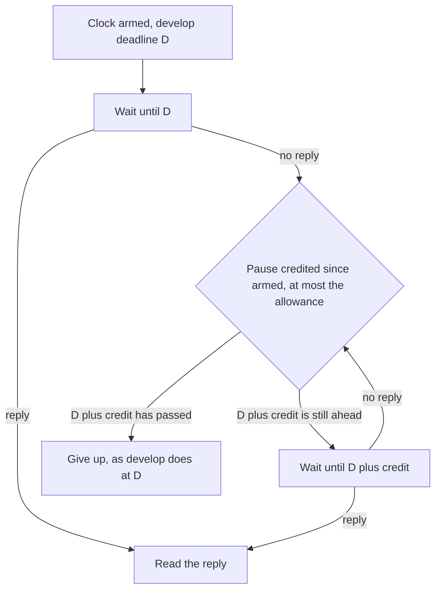

# Step 3b design: the server-pause fix (cards 84 and 72)

The guardrail is the product's first check on every question. This document designs one change to it: step 3b of the accepted guardrail design of 2026-10-08 (`testing/Developer/reports/2026-10-08_guardrail_design/design.md`, section 4), which the lead re-split on 2026-10-08 to be "redone on its own, with follow-up turns in its sweep" (`DECISIONS.md`, 2026-10-08, "The guardrail card (84 and 72) is parked, not merged"). Steps 1, 3a and 3c are live (#227); step 2 is parked on its own data.

Written 2026-10-15 from develop at `7626fe85` (which carries #227 and card 35, #228), the parked code under the local tag `parked/card84-72-guardrail-2026-10-08`, the eight reports of 2026-10-08, the safe part's reports of 2026-10-09, card 35's two verifier reports, and the `DECISIONS.md` rows of 2026-09-25 to 2026-10-15. No source file was changed and no model was called.

The owner's four rules for this change, each held below: nothing admitted that develop refuses; nothing refused that develop admits, except where a recorded owner decision says so; no widening of a security control; Jev charged by the owner's rule as written.

## Table of contents

- [In one minute](#in-one-minute)
- [1. What a person sees today when the server pauses](#1-what-a-person-sees-today-when-the-server-pauses)
- [2. Why the 8 October attempt failed](#2-why-the-8-october-attempt-failed)
- [3. The design](#3-the-design)
- [4. The case grid](#4-the-case-grid)
- [5. Build steps, file fence and tests](#5-build-steps-file-fence-and-tests)
- [6. How the verifier proves the owner's rules](#6-how-the-verifier-proves-the-owners-rules)
- [7. Owner decisions](#7-owner-decisions)

## In one minute

- A "server pause" is a stretch during which the server's event loop runs nothing: one question's synchronous work (the guardrail's own database session for the daily caps is one such place) blocks every other question in flight. Jev's replies are read on three clocks that count that frozen time against Jev, so a freeze at the wrong moment throws Jev's answer away and the guard model's verdict, or a fail-open, decides instead.
- Jev answers in 0.12 to 0.37 s live (median 0.22 s, max 1.59 s in 397 calls), so on develop a freeze has to last about 2.6 s or more before it changes a verdict. No live count of such freezes exists; the shape was only ever seen by forcing it in tests.
- The change: when a Jev reply in the guardrail is late by exactly as much as the server was frozen, the clock gives it that time back, up to an allowance of 2 s. Nothing else changes: with no freeze every cell of the grid is identical to develop in verdict, time and requests. Jev's clocks everywhere else (Think, Plan, the sentence check) keep develop's code path byte for byte.
- The intended differences, both of them only after a freeze: a question Jev calls on topic is answered as it would be without the freeze, instead of being turned away as off topic; a question Jev calls off topic or an injection is turned away as it would be without the freeze, instead of being answered because the freeze hid Jev's answer. The first admits what develop refuses and the second refuses what develop admits, so both need the owner's decision (section 7); without it this card closes as "nothing to build".
- Why the 8 October attempt failed, in one line: it changed how every Jev clock in the product counts time, measured pauses with a loop that could not tell a busy server from a frozen one, and gave each call its own cap, so a freeze could rescue the reply that admits and lose the reply that refuses. The design below gives the injection check a longer allowance than the topic check by exactly Jev's bound, which makes that asymmetry impossible by construction instead of by a rule.
- Grid: about 149,000 cells (144,500 with Jev on, 4,300 off), the same cells run on develop's real code, on the sweep's copy of develop and on the design; the CI gate runs a 12,000-cell subset.

## 1. What a person sees today when the server pauses

### What "server pause" means in this code

The search agent runs every question on one asyncio event loop. When any coroutine does synchronous work, the loop runs nothing else until it returns: no reply is read, no timer fires, for every question in flight. That is a server pause. Places in this code where the loop blocks:

| Where | What blocks | Measured |
|---|---|---|
| `core/graph.py` `guardrail_node`, line 1862 | `with session_scope() as session:` for the two daily caps, a synchronous database round trip on the loop, once per question | Not measured; a slow database holds every other question for the length of the query |
| The guard model's reply parse, the pre-filter, the forbidden screen | CPU work, microseconds | Negligible |
| The knowledge graph (`tools/cypher_query.py`) | Runs under `asyncio.to_thread`, so it does not block | Not a pause source |

The guardrail's Jev replies are read on three clocks, all real time, all started at different moments:

| Clock | Where | Length | Starts |
|---|---|---|---|
| Jev's own total bound | `harness/jev_client.py` `_send`, `asyncio.wait_for(_post, 3.0)` | 3.0 s | When the request is about to go out |
| `decide()`'s outer net | `harness/decide.py` `_jev_attempt`, `asyncio.wait_for(…, 3.5)` | 3.5 s | Before the per-query cap check, a few lines earlier |
| The guardrail's injection net | `core/graph.py` `_jev_injection_pick`, `asyncio.wait_for(…, 3.5)` | 3.5 s | Before its cap check |
| Jev's own window (R-06) | `core/graph.py` `_jev_own_pick_deadline`, 3.75 s after the relevancy decision began | 3.75 s | When the relevancy task first runs |
| Card 35's follow-up bound | `core/graph.py` `_FOLLOW_UP_TOPIC_CHECK_BOUND_S`, 1.5 s after the relevancy decision began | 1.5 s | The same moment |

A freeze of P seconds that lands between a clock's start and the moment Jev's request leaves the server shortens the time Jev has by P. A freeze that lands while the reply is in flight delays nothing on the virtual clock the reviews use (an overdue reply timer runs before an overdue deadline timer), and on real sockets it is a race develop already carries; this design leaves that race exactly as it is, so the yardstick stays develop's code on the same clock.

### What the reports measured

| Source | What was forced | What develop did |
|---|---|---|
| Phase 8.6 fix round, F-8.6-FA03 (2026-09-26) | A pause of about 0.76 s landing while Jev was near its 3 s limit, both forced together | Jev's on-topic answer thrown away; the guard model's off-topic verdict refused the question |
| Card 72 judge, F-72-J03 (2026-09-29) | A 0.6 s pause one step later, in the cap check before Jev's request | The same refusal |
| Guardrail design judge, E4 (2026-10-08) | A 0.6 or 1.0 s pause as Jev's topic request went out, Jev's off-topic reply at 2.5 s | 16 grid cells where develop admits an off-topic question: Jev's reply lost at 3.0 s, then the guard fallback said on topic (admitted at 3.3 or 6.0 s) or hung (admitted by the fail-open at 15.0 s) |
| Guardrail design adversary, A-GR-11 (2026-10-08) | A 3.0 s pause as the topic request went out, Jev on topic at 0.2 s, Jev injection at 2.0 s | Both Jev replies lost; refused as off topic at 3.3 s on the guard model's verdict (a refusal by accident: without the pause, refused as injection) |
| Step 2 data, develop's log (2026-10-05 to 10-08) | Nothing forced: 397 live Jev calls | Median 0.22 s, max 1.59 s, all answered; no log line records a loop freeze, so how often one happens is unknown |

So on develop, with Jev at its live speed, a freeze has to be about 2.6 s or longer, and land between a clock's start and Jev's request, to change a verdict. Nothing in the product counts those freezes.

### What a person sees, in their words

- A freeze turns away a question Jev would have called on topic: they type a question with no obvious biomedical word, the server freezes for a few seconds on someone else's question, and they read "I answer questions about biomedical evidence from NCBI data: genes, variants, diseases, publications, and sequencing records." Asking again works.
- A freeze lets an off-topic question through: Jev's off-topic answer is lost, the guard model's fallback says on topic or hangs, and the question is searched, after up to 15 s.
- A freeze does not change the money counted: a lost reply is a timeout and is charged nothing, as the owner's rule says.

### What step 3b should change, in a person's words

After a server freeze, a question gets the same answer it would have got without the freeze: a question Jev calls on topic is answered, a question Jev calls off topic or an injection is turned away. The guardrail never admits a question without the guard model's own verdict, never lets one reply race another, and never lets Jev remove a refusal; it only stops throwing Jev's answer away for time the server took. A freeze longer than the allowance behaves as today.

## 2. Why the 8 October attempt failed

The parked code (tag `parked/card84-72-guardrail-2026-10-08`, files `jev_client.py`, `decide.py`, `graph.py`, the sweep and the virtual clock) replaced every Jev clock with `wait_counting_free_time`, a 50 ms look loop that counted only looks that came back on time, with a real-time cap of the bound plus 2 s, and replaced R-06's window with a signal from `decide()`. Its judge said MERGE with eight minors, its adversary FAIL on A-GR-11, its fix round added the "injection pick unknown refuses" rule, and the fresh verifier said DO NOT MERGE. Each finding traced to a mechanism, and what this design does about it:

| Finding | What went wrong | Mechanism | Here |
|---|---|---|---|
| A-GR-11 (adversary, major) | After a 3 to 4.5 s pause, a question the guard model called off topic and Jev called injection was admitted; develop refuses it | M1: each Jev call had its own real-time cap from its own start. Jev's fast on-topic reply (0.2 s) fitted under the topic call's cap and set the guard verdict aside; Jev's slower injection reply (2.0 s) missed the injection call's cap. The admitting reply survived the pause and the refusing one did not | The injection check's allowance is the topic check's plus Jev's whole bound (section 3), so no topic reply can be rescued while an injection reply that Jev delivers inside its bound is lost. Proved by the grid and by the mutation that removes the extra allowance |
| V-GR-04 (verifier, major): 273 cells refused that develop admits with and without the pause | The fix-round rule "an injection pick lost to a pause refuses" also fired on a hung injection call (255 of 273) and on a usable reply cut by the cap | M2: "lost to the pause" and "Jev hung" cannot be told apart once a cap cuts the wait short, and the rule chose refuse for both | No rule reads the loss of a reply as a reason to refuse. Every reply is read as develop reads it (a pick, or no pick), only later when the server was frozen |
| V-GR-08 (verifier, major): a merely busy server refused what develop admits | The look loop treated every late look as a pause, so a loop busy in 30 ms chunks counted no time and the injection wait ended on its cap as "lost to a pause", firing the V-GR-04 rule | M4: the loop could not tell a busy server from a frozen one | A look late by under a quarter of a second counts in full. Only a single late return of 0.25 s or more is a pause. A loop busy in 60 ms chunks gives cells identical to develop (section 4, the busy-loop axis) |
| A-GR-06, V-GR-09 (major): every hung Jev call on a busy server took 5 to 7 s instead of 3, at every Jev-decided point | The same M4, and M5: the clock lived in the shared `_send`, so Think, Plan and the sentence check inherited it | M4 and M5 | The credit is a parameter of `_send` and `call_jev`, default 0, passed only by the guardrail's two calls. `call_jev_batch` and every other caller run develop's `asyncio.wait_for` line unchanged |
| J-GR-06 (judge, minor): the sentence check's Jev calls ran past the Write step's budget after a pause | M5 | M5 | Same: the sentence check is outside the fence by construction, not by a test |
| V-GR-01 (verifier, critical): the follow-up path still admitted after a 4 to 4.8 s pause | The A-GR-11 rule was added in the R-03 branch only; the memory-bound follow-up branch also sets the guard's off-topic verdict aside and never read it. The sweep's `run_case` had no session memory, so no cell reached that branch | M3: two set-aside branches, one patched; a gate that could not reach the other | No per-branch rule exists to forget. The grid carries three follow-up shapes with session memory (section 4), so both set-aside branches and card 35's bound are in every run |
| V-GR-11 (verifier): every Jev reply charged the $0.0001 floor instead of the cost it states | The fix brief told the agent to raise a stated cost below the floor to the floor, which the owner's rule does not say | M6: a paraphrase of the owner's rule in a brief | The charge code is not in the fence. The rule is quoted verbatim in section 5 and the verifier probes two charge cases through the real `call_jev` |
| A-GR-12, V-GR-05 (major, minor): the sweep's gate paused only at 0, 0.6 and 1.0 s, never during the injection call, filed every refusal past the allowance as "the named residual" without asking develop, and capped the kept admission class at the grid's size | M7: the classes were written from the builder's expectation, not from develop's verdict on the same cell | M7 | Every class predicate compares the design's verdict with develop's on the same cell and with develop's on the cell's no-freeze twin (section 6); a cell that fits no predicate is a failure |
| J-GR-01, A-GR-08 (minor): a pause still cost Jev up to 0.1 s of its clock | M4: the loop counted an interrupted look as the look plus slack | M4 | A look late by under the threshold counts what it took; a reply within the bound is never lost to a short pause |
| J-GR-02 (minor): "a pause over 2 s ends Jev's clock" was not what the code did | The cap was the bound plus 2 s of real time, not a 2 s pause | M8: a hand-rolled loop whose rule drifted from its comment | The rule is stated once (section 3): the deadline is develop's deadline plus the credited pause, the credit at most the allowance. The test for it is the statement |
| J-GR-03, A-GR-14, A-GR-09 (minor): a frozen or backward clock, a NaN budget, never ended the wait | M8 | M8 | The helper keeps `asyncio.wait` as its only sleep, bounds its looks, and with a credit of 0 is `asyncio.wait_for` itself |
| A-GR-07 (minor): past the allowance a reply already in hand was thrown away | The cap was checked before the reply was read | M8 | A task that is done is returned before any clock is read |
| J-GR-07 (minor): the sweep did not count Jev requests in flight | A hole in the gate | M7 | The Jev stub counts requests by kind, active and peak, like the guard stub |

The lesson that shapes this design: a guardrail timing change passes review only when the rule is one sentence, when the cells it changes are decided by develop's own verdicts rather than by a list of residuals, and when the asymmetry between an admitting and a refusing reply is impossible rather than handled.

## 3. The design

### Rules every part keeps

- No question is admitted without the guard model's own verdict (unchanged code).
- One reply decides each attempt; no two replies race (unchanged).
- Jev can add a refusal and never remove one (unchanged).
- The topic check's fail-open rule, the 15 s budget, the classifier's two attempts and the rate-limit handling stay as they are (untouched files).
- Card 35's 1.5 s follow-up bound stays a real-time clock, unchanged. A freeze longer than about 1.2 s there still admits the follow-up exactly as develop does.
- Jev is charged by the owner's rule as written (unchanged code; quoted in section 5).

### The one rule

A Jev reply in the guardrail that arrives after its clock ran out is still read when the server was frozen for at least that long while the clock ran, up to an allowance. In code: each of the guardrail's Jev clocks keeps develop's deadline; when it reaches the deadline with no reply, it adds the pause it measured since it started, at most the allowance, and waits on; it gives up when the deadline plus the credit has passed.

How the pause is measured: the wait sleeps in looks of at most 50 ms (`asyncio.wait({task}, timeout=look)`). A look that comes back late by 0.25 s or more (`_PAUSE_MIN_S`) is a pause of that excess, and the excess is credited. A look late by less counts what it took, as develop's own timer would. So a loop busy in short chunks credits nothing and matches develop; a loop frozen for a second credits a second. There is no process-wide monitor and no shared state between questions: each clock measures the pauses that overlapped it, and two clocks running at once see the same freeze.

The allowances:

| Clock | Allowance | Why |
|---|---|---|
| The topic check's Jev call (through `decide()`): `_send` 3.0 s and `_jev_attempt` 3.5 s | `JEV_PAUSE_ALLOWANCE_S` = 2.0 s | The design's agreed figure. Covers a freeze of up to 2 s wherever it lands, and up to 4.7 s when it lands before Jev's request and Jev answers at its live speed |
| The injection check's Jev call (`_jev_injection_pick`): `_send` 3.0 s and its net 3.5 s | 2.0 s plus Jev's bound (3.0 s) = 5.0 s while the topic check's Jev reply is still pending or was rescued; 2.0 s once the topic check settled on develop's own clock | The asymmetry of A-GR-11 needs a topic reply rescued and an injection reply lost. A rescued topic reply arrives within 3.0 s plus 2.0 s of its start; an injection reply Jev delivers inside its own bound arrives within the freeze plus 3.0 s. With 5.0 s of allowance the second always fits whenever the first does, so a rescued topic reply can never stand beside a lost injection reply. Once the topic reply was read on develop's own clock, nothing can be rescued and the longer wait buys only a refusal, so the allowance drops to 2.0 s |
| Jev's own window (R-06, 3.75 s) | Replaced by a signal | A real-time window cannot be credited from the guardrail, since the pauses it would need to credit happened inside `decide()`. `decide()` sets `jev_failed` the moment Jev's own pick can no longer come; the R-03 wait ends at the first of the task finishing, the signal with the window already passed, or the step deadline. "With the window already passed" keeps every no-freeze cell's timing identical to develop (develop waits to 3.75 s even when Jev failed at 0.1 s); ending sooner is a separate improvement, not this card |
| Card 35's follow-up bound (1.5 s) | None | The owner's bound; unchanged |
| The classifier's attempts, the step deadline | None | Unchanged |

The pieces, each small:

| Piece | File | What it is |
|---|---|---|
| `wait_with_pause_credit(awaitable, budget_s, allowance)` | `harness/jev_client.py` | The helper above. `allowance` is a float or a callable returning one (the injection check's allowance moves). With an allowance of 0 it returns `await asyncio.wait_for(awaitable, budget_s)`, develop's line, so every caller that passes nothing runs develop's code path |
| `_send(..., pause_allowance=0.0)` and `call_jev(..., pause_allowance=0.0)` | `harness/jev_client.py` | Thread the allowance to Jev's own bound. `JevResult.rescued_by_pause: bool = False` says the reply came after develop's deadline. `call_jev_batch` is not touched |
| `_JevWatch` | `core/graph.py` | One object per question, created in `guardrail_node`: `failed` (an `asyncio.Event`, the signal), `settled` (an event: Jev's phase of the topic check is over, pick or failure), `rescued` (bool). Passed to the topic decision and read by the injection pick's allowance callable |
| `decide(..., jev_watch=None)` | `harness/decide.py` | With a watch: `_jev_attempt` and `_run_jev_pick` pass `JEV_PAUSE_ALLOWANCE_S` down; on Jev's pick, `watch.rescued = result.rescued_by_pause` and `settled.set()`; on Jev's failure, `failed.set()` and `settled.set()` before the guard fallback is asked; with the guard provider, both set at once. Without a watch: develop's code path, every line |
| `_await_jev_own_pick(task, watch, window_deadline, step_deadline)` | `core/graph.py` | Replaces the three waits on `_jev_own_pick_deadline`: the R-03 set-aside, the certain-refusal read, and card 35's `min(follow_up_deadline, window)`, which becomes `min(follow_up_deadline, this)` |
| The credit log line | `core/graph.py` | One INFO line when a credit above 0 was used: the point, the credit in seconds and whether a reply was read because of it. This is the live count of freezes the product lacks today |

What a person gets, by the shape of the freeze (Jev on; with Jev off nothing changes):

| Freeze | Today | With the change |
|---|---|---|
| Under 0.25 s, or a server busy in chunks under 0.25 s | No effect | No effect; identical cells |
| Up to 2 s, anywhere | A verdict changes only if Jev was already near its bound (over 1 s for a 2 s freeze); otherwise no effect | The no-freeze verdict, up to the freeze later |
| 2 to about 4.7 s, landing before Jev's request | With Jev at its live speed, Jev's answers are lost: an on-topic question refused, an off-topic one searched | The no-freeze verdict; Jev's answers are read when they arrive |
| Longer than that | Jev's answers lost | Jev's answers lost, as today. A hung Jev injection check waits up to 5 s longer than today before the question goes on, only while a rescued topic reply is in hand |
| A server busy in chunks of 0.25 s or more | Develop's timers also run late, by up to one chunk | A hung Jev check in the guardrail ends up to the allowance later than today (2 s, or 5 s in the injection case above); a reply that arrives is read as today |

Money: a rescued reply is a reply that reached the provider, so it is charged what it states under the owner's rule; develop charged that call nothing, as a timeout. At Jev's live price that is about $0.00002 more on a question whose reply was rescued, and nothing on any other.

### Options weighed and not taken

| Option | Why not |
|---|---|
| The parked design as it stands (free-time clock in `_send`, per-call caps, the "unknown refuses" rule) | Section 2: the busy-server cost on every Jev-decided point, the asymmetry at the cap edge, and a rule that refused what develop admits |
| The signal alone, no credit | Fixes only a freeze landing in the few lines between the topic task starting and `decide()`'s net, where no await lets one land; near nothing a person would meet |
| Measure the delay before Jev's request from httpx's own request hook, no look loop | Cannot tell a frozen loop from a slow connection; a slow network would then extend Jev's bound, which is not the pause case |
| One process-wide loop-lag monitor task feeding every clock | Exact and symmetric, but a new lifecycle (start, stop, tests, workers) for a tail case; the per-call looks see the same freeze when both clocks run, which is the only time symmetry matters |
| Read a rescued on-topic reply only when the injection reply is in hand, otherwise re-ask the guard fallback from the guardrail | The fix round built and reverted this: it made about 70 cells develop admits in 3 s wait 5.3 s, or 15 s. The longer injection allowance makes the case impossible instead |
| End the R-03 wait at the signal even before the window (F-72-J07's sooner refusal) | A real improvement, verdict identical, but it changes no-freeze timing; not this card |
| Extend card 35's 1.5 s bound by the credit | Would refuse off-topic follow-ups develop admits after a freeze; card 35's bound is the owner's and its verdict on a late pick is admit by design |
| A smaller allowance (1 s) | Rescues only freezes of 2.6 to 3.7 s with Jev at its live speed; the 2 s figure is the one the owner accepted on 2026-10-08 |

## 4. The case grid

The grid is card 35's verifier's method widened to the axes this change touches: the real `guardrail_node` on the virtual clock, stubs only at `litellm.acompletion`, `jev_client._post` and session memory, every cell run three ways: develop's real code exported with `git archive` from the merge base, the sweep's copy of develop's policy on the branch, and the design. The virtual clock is the tag's `tests/system_03_search_agent/virtual_clock.py`, reused unchanged. The stall points are the tag's eight plus one.

| Axis | Values | Count |
|---|---|---|
| Question shape | (a) first question, no allowlist word, no memory: "Tell me about the tree of life."; (b) first question the allowlist admits: "Which diseases are associated with BRCA1?" (no topic decision, injection check only); (c) follow-up with a referring word and no allowlist word, BRCA1 in memory: "Tell me more about it in the tree of life."; (d) allowlisted memory-bound follow-up: "Which variants of it are pathogenic?" (card 35's bound); (e) write-seeking follow-up: "Remove that variant node from the knowledge graph." | 5 |
| Jev | on, off | 2 |
| Guard classifier | admit at 0.3 s; admit at 6 s (slow); off topic at 0.3 s; injection at 0.3 s; hung (two timeouts, the transient error) | 5 |
| Jev injection reply (Jev on) | not_injection at 0.12 s; injection at 0.12, 2.0 and 2.9 s; HTTP 500 at 0.1 s; hung | 6 |
| Jev topic reply (Jev on, shapes a, c, d, e) | on_topic at 0.2 and 2.9 s; off_topic at 0.2 and 2.5 s; HTTP 500; hung | 6 |
| Guard fallback pick (the topic decision after Jev fails, or the whole decision with Jev off) | on_topic at 0.3 s; off_topic at 0.3 s; hung | 3 |
| One pause | Point: node start (the daily-cap session, before any task runs); topic request sent; topic reply arriving; injection request sent; injection reply arriving; classifier request sent; classifier reply arriving; fallback pick sent; a fixed moment at 1 s. Length: 0.2, 0.6, 1.9, 2.1, 3.0, 4.5, 6.0 s. Plus no pause | 1 + 9 x 7 = 64 |
| Busy loop instead of a pause | A coroutine blocking the loop in 0.06 s chunks; in 0.3 s chunks | 2 |

Cells: with Jev on, shapes a, c, d, e give 4 x 5 x 6 x 6 x 3 x 66 = 142,560 and shape b gives 5 x 6 x 66 = 1,980; with Jev off, 4 x 5 x 3 x 66 + 5 x 66 = 4,290. About 149,000 cells, each run three ways. At the tag's measured pace (16,800 cases in 46 s, two runs each) the full grid is about nine minutes; the CI gate runs the subset with pauses 0, 0.6, 2.1 and 4.5 s at four points, three classifier outcomes and four replies per Jev axis, about 12,000 cells, under two minutes.

Every cell records the verdict (admit, or the refusal's category, or the step error's class), the time, the requests sent by kind, the peak in flight by kind (Jev requests included), and whether a credit was used.

### How a cell's verdict is decided, and the only intended differences

For a Jev reply, its arrival falls in one of these classes relative to the clock that reads it:

| Arrival class | Meaning | Develop | Design |
|---|---|---|---|
| Read | Arrives within develop's deadline (the freeze did not delay the request, or Jev was fast enough anyway) | Reads it | Reads it, same moment |
| Rescued | Arrives after develop's deadline but within the deadline plus the credited freeze (at most the allowance) | Lost: a timeout | Read |
| Lost | Arrives after the deadline plus the credit (the freeze was longer than the allowance) | Lost | Lost, as develop |
| Hung or error | Never arrives, or an error status arrives | Timeout, or the error, as a no-pick | The same, up to the credit later |

The design's verdict in a cell is develop's verdict on the cell in which every rescued reply is instead read on time and every lost reply stays lost. Because the injection check's allowance exceeds the topic check's by Jev's bound, "topic rescued and injection lost" has no cell; the combinations that remain and the verdict each gives:

| Topic reply | Injection reply | Branch | Develop, as timed | Design | Same cell with no freeze (develop) | Class |
|---|---|---|---|---|---|---|
| Read | Read | any | develop's | identical | identical | Identical |
| Rescued on_topic | Read or rescued not_injection | Guard said off topic (R-03), or follow-up set-aside | Refused off topic (Jev's pick lost, guard verdict stands) | Admitted | Admitted | C1: admitted where develop refuses, the no-freeze verdict |
| Rescued on_topic | Read or rescued injection | any | Refused off topic (R-03) or injection | Refused injection | Refused injection | C3: refused either way, the no-freeze category |
| Rescued on_topic | Read or rescued not_injection | Guard admitted | Fallback decides: admitted, or refused off topic, or admitted at 15 s on a hang | Admitted | Admitted | C1 where develop refused on the fallback; identical otherwise |
| Rescued off_topic | any | any | Fallback decides, or (R-03) refused off topic | Refused off topic | Refused off topic | C2: refused where develop admitted on the fallback or the fail-open; identical where develop refused |
| Lost | Rescued injection | any | Classifier verdict; fallback for topic | Refused injection | Refused injection | C2 or C3 |
| Lost | Rescued not_injection | any | develop's | identical | may differ | Identical to develop; no rescue possible |
| Lost | Lost | any | develop's | identical, up to the credit later | may differ | Identical verdict; timing class C4 |
| Hung | any | any | Fallback after 3.5 s | Fallback after 3.5 s plus the credit | same | C4: same verdict, later by at most the credit |
| any | Hung | any | Classifier verdict after 3.5 s | Same, after 3.5 s plus the credit (up to 5 s while a rescued topic reply is in hand) | same | C4 |
| Any, Jev off | none | any | develop's | identical | identical | Identical |
| Any, guard classifier hung | any | any | Transient step error at 15 s | identical | identical | Identical |
| Any, busy loop in 0.06 s chunks | any | any | develop's | identical | identical | Identical |
| Any, busy loop in 0.3 s chunks | any | any | develop's, timers late by up to a chunk | Same verdict; a hung Jev check up to the allowance later | same | C4 |

The classes, written as predicates the sweep applies to each cell, with D the develop verdict, N the design's, D0 develop's on the no-freeze twin:

| Class | Predicate | Allowed |
|---|---|---|
| Identical | N = D in verdict, requests and time (time within one look) | Always |
| C1 | D refuses, N admits, D0 admits, the cell has a freeze or a chunky loop, and N's admission rests on Jev's own on-topic pick (the record says `decided_by == "jev"`) | Only with the owner's yes to decision 1 |
| C2 | D admits, N refuses, D0 refuses with N's category | Only with the owner's yes to decision 1 |
| C3 | D and N both refuse, different categories, N's is D0's | With decision 1 |
| C4 | N = D in verdict; N later than D by at most the credit used, which is at most the allowance (2 s, or 5 s only in the injection-hung-with-rescued-topic cell), and never past the step deadline; or N sooner | Always, as the named cost |
| Anything else | | A failure: the sweep is red and prints the cell |

The sweep also scans every design result for the invariants the 8 October judge scanned: admitted with the classifier hung, 0; admitted though a judge said injection, 0; an off-topic verdict set aside without Jev's own on-topic pick or the follow-up rule, 0; past 15 s, 0; two requests of one kind in flight, Jev's included, 0; a no-freeze cell with any credit used, 0.

## 5. Build steps, file fence and tests

### File fence

| File | Change allowed |
|---|---|
| `src/system_03_search_agent/harness/jev_client.py` | `wait_with_pause_credit`, `_PAUSE_MIN_S`, `_LOOK_S`, `JEV_PAUSE_ALLOWANCE_S`; the `pause_allowance` parameter on `_send` and `call_jev`; `JevResult.rescued_by_pause`. Not `call_jev_batch`, not `jev_charge_usd`, not `_json_payload`, not any charge line |
| `src/system_03_search_agent/harness/decide.py` | `jev_watch` on `decide()`, `_jev_attempt` and `_run_jev_pick`; the allowance passed only when a watch is given. Not `_guard_fallback_pick`, not the record builders, not the charge line |
| `src/system_03_search_agent/core/graph.py` | `_JevWatch`; `guardrail_node` creating it; `_relevancy_decision` and `_decide_point` carrying it; `_jev_injection_pick` using the helper with the moving allowance; `_await_jev_own_pick`; the three wait sites; the credit log line. Not the classifier attempts, not the forbidden screen, not `_is_memory_bound_follow_up`, not `_FOLLOW_UP_TOPIC_CHECK_BOUND_S`, not any charge line, not any step-error dict |
| `tests/system_03_search_agent/virtual_clock.py` | Taken from the tag unchanged |
| `tests/system_03_search_agent/guardrail/test_guard_request_dominance.py` | Rebuilt from the tag: yardstick copies re-derived from today's `graph.py` (card 35's bound and its `min` with the window included), session memory in `run_case`, the axes of section 4, the classes and invariants of section 4, the CI subset and the full grid behind a marker |
| `tests/system_03_search_agent/guardrail/test_followup_guardrail.py` | The R-06 window tests kept; pause arms added on the virtual clock |
| `tests/system_03_search_agent/harness/test_jev_client.py`, `test_decide.py` | The helper's and the watch's tests |
| `docs/build/Debugging_guide.md` | The `jev_client` row: the allowance, in one sentence |
| Everything else | Untouched: `synthesis/sentence_check.py`, `harness/harness.py`, `cost_control.py`, the contracts, the frontend, the prefilter and forbidden screens |

Jev's charges are outside the fence. The rule they follow, quoted from `DECISIONS.md` (2026-09-29) so no brief paraphrases it: "A Jev reply that reached the provider is charged the cost it states when that is above $0 and at most `MAX_JEV_COST_USD`, otherwise a floor near Jev's real price, about $0.0001, never $0; this amends R-10's line 3, which said at least one cent". And its reading of 2026-10-09: "charges a Jev reply that states more than `MAX_JEV_COST_USD` the floor, as the owner's row of 2026-09-29 reads literally". A rescued reply is a reply that reached the provider and is charged by this rule as the code already does; a call given up is a timeout and is charged nothing.

### Build steps, one ticket each, in order

| Ticket | What | Tests that bite (each mutated once and restored) |
|---|---|---|
| 1 | `jev_client`: the helper and the parameter | With allowance 0 the helper is `asyncio.wait_for` (monkeypatch `asyncio.wait_for`, assert it is called; assert `call_jev_batch` and a plain `call_jev` never credit); a look late by 0.25 s credits it, late by 0.2 s does not; the credit is capped at the allowance; a reply in hand is returned before any clock is read; a reply arriving after the deadline plus the credit is lost and the call cancelled; a NaN, infinite, zero or negative budget ends at once; a frozen or backward clock ends on the look limit; a busy loop in 0.06 s chunks ends within one chunk of the budget; `rescued_by_pause` is True only for a reply read after the deadline. Mutations: threshold 0 (the busy-loop arm fails); credit uncapped (the cap arm fails); the done-check after the clock (the in-hand arm fails) |
| 2 | `decide`: the watch | The watch is set before the guard fallback is asked; `rescued` is True for a rescued pick and False for a read one; with the guard provider both events are set at once; without a watch `_jev_attempt` passes no allowance (assert `call_jev` was called with the default). Mutation: the signal never set (the mid-wait test fails) |
| 3 | `graph`: the watch, the waits, the injection allowance, the log line | On the virtual clock through the real node: the six stall arms of the tag's test rewritten to the new rule (a pause at the node start, in the cap check, as the topic request is sent, mid-wait, as the reply arrives, as the injection request is sent), each with the no-freeze twin asserted equal; the A-GR-11 shape (guard off topic, Jev on topic at 0.2 s, Jev injection at 2.0 and 2.9 s, pauses 3.0 to 4.8 s) refused as injection; the V-GR-01 shape with session memory refused; the V-GR-04 shape (injection hung, 5.5 s pause, Jev on topic read on develop's clock) admitted as develop; card 35's bound cells identical; the no-freeze R-03 refusal at the window, not before; the credit line present once and absent with no freeze. Mutations: the injection allowance equal to the topic allowance (A-GR-11's shape admits, red); the signal without the window (the no-freeze timing arm fails); the watch not passed to the injection pick (the allowance never moves, the 5 s cost arm fails) |
| 4 | The sweep | The yardstick equals develop's real code on every cell of the CI subset (the builder's one-off three-way run, pasted); the CI subset green with every differing cell in C1 to C4; the full grid run once and its counts by class pasted into `build.md`; the four "catches" tests from the tag kept (a hedge, a backoff, a wait held for the fallback, Jev removing a refusal) plus two new: the classes red when C1 is allowed without decision 1's flag, and red on a cell outside every class |
| 5 | Docs | The debugging guide row; `build.md` with the counts, the deviations and the learnings; `DECISIONS.md` rows for the owner's answers; the board row for cards 84 and 72 |

The branch is `fix/card84-72-server-pause` from develop `7626fe85`, one pull request into `develop`, the guardrail's usual review: builder, judge, adversary, one fix round at most, fresh verifier. No live model calls are needed; the design spends nothing.

### Deviations the builder must not make

- No rule that reads a lost or unknown Jev reply as a reason to refuse or to admit.
- No change to how any clock outside the guardrail's two Jev calls counts time.
- No change to R-06's no-freeze timing: the signal ends the wait only once the window has passed.
- No change to card 35's bound, the forbidden screen's order, or the charge lines.

## 6. How the verifier proves the owner's rules

The verifier works from a fresh context, with develop's real code exported from the merge base and the branch's node, both on the tag's virtual clock, and writes its own probes, not the builder's.

| Rule | Proof |
|---|---|
| The yardstick is develop | The full grid of section 4 run on the exported develop and on the branch's yardstick copies: identical in verdict, time, requests and peak in flight in every cell. The 8 October judge's E2 and the verifier's V-GR-02 did this and it is repeated |
| Nothing admitted that develop refuses | Over the full grid, for every cell where develop refuses and the design admits: the cell has a freeze or a chunky loop, develop admits the same cell with no freeze, and the admission rests on Jev's own on-topic pick. Count by shape, pasted. Any other admission is a failure. With decision 1 a no, this set must be empty |
| Nothing refused that develop admits, except by owner decision | For every cell where develop admits and the design refuses: develop refuses the same cell with no freeze, with the design's category. Count pasted. With decision 1 a no, empty |
| No widening of a security control | The invariant scan of section 4 over every design result; and a read of the diff: no line removes a refusal, no line reads a missing reply as a pick, the forbidden screen and the injection "adds only" rule are untouched |
| No no-freeze change | Every cell with no pause and no chunky loop, Jev on and off, all five shapes: identical in verdict, time and requests. The busy-loop 0.06 s cells too |
| The timing cost is bounded | For every C4 cell the lateness is at most the credit used; the maximum per shape pasted; none past the step deadline; the 5 s cost appears only in the injection-hung-with-rescued-topic cells |
| Follow-ups are covered | Shapes c, d and e carry session memory in every run; the set-aside branch, card 35's bound and the write-seeking order each have cells whose verdict the verifier reads by hand |
| The asymmetry is impossible | Mutation: the injection allowance set equal to the topic allowance; the full grid must show "design admits, develop refuses, no-freeze refuses" cells (A-GR-11's shape) and the sweep must be red. Restored, green |
| The busy server is not a pause | Mutation: `_PAUSE_MIN_S` set to 0; the 0.06 s chunk cells must come out later than develop and the sweep red. Restored, green |
| The fence holds | `git diff --stat` over the untouched files is empty; a probe of `call_jev_batch` and a Think decision under a 1.5 s pause gives develop's timing to the look |
| Jev charged by the rule as written | Two probes through the real `call_jev` with `_post` stubbed: a reply rescued after a 1 s pause stating $0.00002 is charged $0.00002; a call given up is charged nothing. The 142-case charge probe of the safe part's verifier (V-GRS-03) rerun unchanged |
| The tests bite | The five mutations of section 5, each run by the verifier, each red then green |

Only read, never probed, and the verifier says so: the real-socket race between an overdue deadline and a reply that arrived during a freeze (develop's and the design's alike); how long the daily-cap session blocks the loop live; how often a live freeze happens, which the credit log line will show after merge.

## 7. Owner decisions

Each is yes or no, the recommendation first. Rule 2 says a refusal of what develop admits needs a recorded owner decision; rule 1 allows no admission of what develop refuses at all. The change's purpose is both, so it cannot ship on the rules as written without the first answer.

1. Recommend yes. After a server freeze, a question gets the verdict it would get without the freeze: a question Jev calls on topic is answered (today refused as off topic), and a question Jev calls off topic or an injection is turned away (today sometimes searched). Yes means the yardstick for a frozen cell is develop on the same cell with no freeze; the grid proves nothing else moves. No means step 3b closes with nothing to build, develop's guardrail being the safe direction, and the credit log line can still ship alone to count freezes.
2. Recommend yes. The allowance is 2 s for Jev's topic check and 5 s for its injection check while a rescued topic reply is in hand. Cost: after a freeze, a question whose Jev check hangs waits up to that much longer than today before it goes on; with no freeze, nothing. No means a 1 s allowance, which rescues freezes of 2.6 to 3.7 s only with Jev at its live speed.
3. Recommend yes. Ship the credit log line with the change, so the product counts live freezes from the first day. No means the count stays unknown.

What this design does not ask: it does not ask to end a refusal sooner when Jev fails outright (F-72-J07), and it does not ask to credit card 35's bound. Both are separate cards if the owner wants them.
