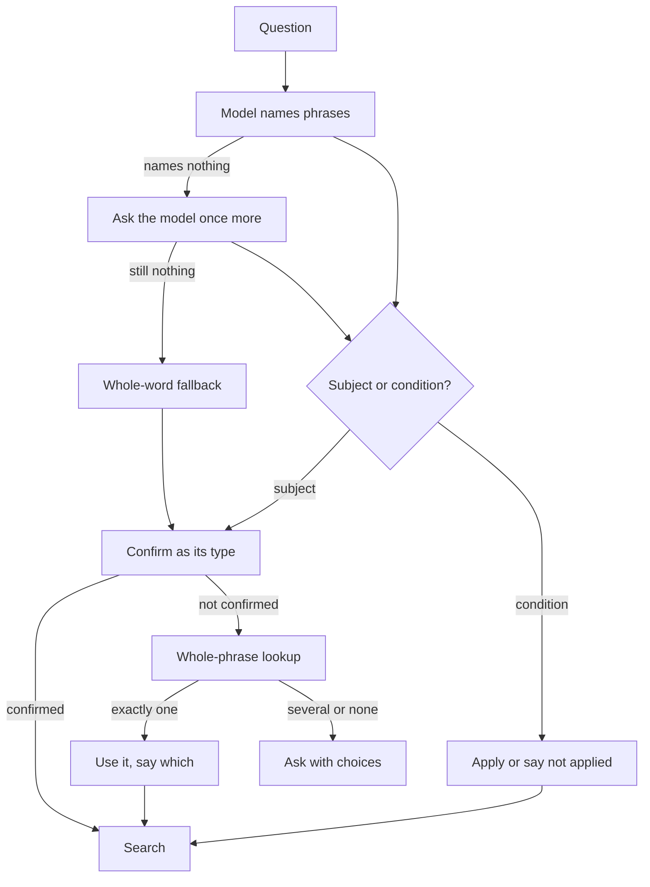

# Card 56 design: reading what a question names

The design for card 56's next build, written by the lead on 2026-10-17 from the product owner's three calls of the same day and the code map beside this file (`code_map.md`). Nothing here is built. The product owner reads it, answers the questions at the end, and only then does a build start.

## Table of contents

- [What a person sees today](#what-a-person-sees-today)
- [The owner's three calls](#the-owners-three-calls)
- [What the code map changed](#what-the-code-map-changed)
- [The design](#the-design)
- [What stays as today](#what-stays-as-today)
- [Speed and cost](#speed-and-cost)
- [How it is checked before merge](#how-it-is-checked-before-merge)
- [Questions for the owner](#questions-for-the-owner)

## What a person sees today

The plain question "Find SRA runs of SARS-CoV-2 sequenced on Illumina from clinical respiratory samples" answers on most runs since the fix merged on 6 October (pull request #186). Four cases still fail:

| The person types | What happens | How often |
|---|---|---|
| "SARS CoV-2" with a space | Answered about the disease SARS, a different virus | 1 of 6 live runs (adversary round 3) |
| A SARS-CoV-2 question after a BRCA1 question | The search runs on BRCA1, the remembered gene | Whenever the model misses the virus; reproduced offline |
| "SRA runs from AML-derived cell lines" | The leukaemia is lost and a search for the literal words finds nothing | 1 of 3 live runs |
| A SARS-CoV-2 question that says "Illumina" | "Illumina" is read as a gene that does not exist, and the answer refuses | 7 of 20 live runs |

One root under all four: when the question-reading model misses or mislabels a word, code fills the gap by guessing:

- It cuts a word into pieces ("SARS" out of "SARS CoV-2").
- It reuses the last subject (BRCA1).
- It keeps a search condition as a gene ("Illumina").

Each guess can land on a real record that answers a different question. Think of a librarian handed a request slip with a smudged title: today they search for the one legible word, or fetch the book the reader asked for last time. The design has them look up the whole title, and ask the reader when it is still unclear.

## The owner's three calls

Decided on 2026-10-17 (`DECISIONS.md`):

1. When the system cannot tell what a named word is, it looks the whole phrase up in NCBI. When exactly one record fits, it uses it and says which. Otherwise it asks the person, with the choices found. It never cuts a word into pieces.
2. A remembered subject fills in only when the question names no subject of its own. It never replaces a name that could not be read.
3. The model marks each phrase as a subject or a condition. Only subjects go through check-then-ask. A condition is applied where the database supports it, or the answer says it was not applied.

## What the code map changed

Measured on 2026-10-17 (`code_map.md`, sections "Findings that change the design's premise" and E):

| Finding | Consequence for the design |
|---|---|
| On the failing runs the model names nothing at all (5 of 26 runs), so there is no phrase to look up | Something must name the phrase first: the model asked once more, then a whole-word fallback, guarded rather than removed |
| Removing the word fallback breaks questions that work today: GCK, lower-case "brca1", the BRCA1 flagship, MODY | The fallback stays, guarded |
| "Exactly one fits" by raw counts is true for 5 of 14 phrases; Gene across all organisms is never one for a real gene symbol (TP53 has 684 records); MedGen's loose title search is "several" for almost anything | "Fits" is defined per database, below, and a phrase that already confirmed is never looked up again |
| The whole phrase works for the card's question: "SARS CoV-2", "sars cov 2" and "COVID-19 virus" each give exactly one Taxonomy record, 2697049 | Call 1 holds for the card's own question |
| A piece looked up alone is a new confident wrong answer: "SARS" alone is exactly one Taxonomy record, the 2003 SARS virus | Never cut a word, in the lookup as in the fallback |
| "CF" fits exactly one record, the gene CFTR, because MedGen has no title "CF" | A single fit can still be the wrong reading; the answer must say which record it used |
| A lookup costs up to 5 NCBI calls and counts against the 20 per question | The lookup gets its own small cap |
| Pathogen Detection's isolate search accepts no conditions | Isolate conditions are always "not applied" |

## The design

How one word is read, from the question to the search:

### Part 1, the whole-phrase lookup (call 1)

- Runs only for a subject phrase that did not confirm as the type the model gave it. A confirmed gene, disease or organism is never looked up again, so BRCA1, MODY and GERD answer as today.
- Looks the whole phrase up, never a piece:
  - Taxonomy: the phrase as a name.
  - Gene: the phrase as a symbol in the question's organism, human when none is named.
  - MedGen: the existing exact-title rule, not the loose title search.
- Exactly one record across the three: it is used, and the answer's plan line says so in words: "Read 'SARS CoV-2' as the virus SARS-CoV-2 (NCBI Taxonomy 2697049)".
- Several, or none: the person is asked, with the choices found as buttons, through the existing ask-back. With none, the ask says what to type next.
- Cap, the lead's proposal: at most two phrases per question. A lookup takes up to five NCBI calls, so at most ten, counted apart from the 20-call limit so a gene question's own searches are never squeezed out. Never on the isolate path, which reads organisms from its own table as today.

### Part 2, when the model names nothing (the map's main finding)

- Today a reply that names nothing goes straight to the word fallback. Instead, the model is asked once more, only when its reply names nothing or contradicts itself (it says the question asks for SRA runs and names no organism). A reply that names something pays nothing.
- If the second reply still names nothing, the word fallback runs, guarded: a candidate is a whole word only, never a piece of a word joined by a hyphen or followed by a second word of the same name ("SARS" in "SARS CoV-2" is never a candidate). Each candidate then goes through Part 1's lookup like any other phrase.
- Open: whether to ask the person straight away instead of running the fallback (question 1 below).

### Part 3, remembered subjects (call 2)

- A new yes-or-no decision for the classifier model: "does this question name a subject of its own?". It is asked only when memory exists and nothing resolved this turn, so ordinary follow-ups pay nothing extra.
- Yes: the question goes through Parts 1 and 2, never to memory. "Find SRA runs of SARS CoV-2" after BRCA1 is read or asked about, never searched as BRCA1.
- No: memory fills the subject as today. "What variants cause it?" after BRCA1 answers about BRCA1.
- It replaces today's word list (`_REFERRING_WORDS`), which misread "each one" in the card's own question.
- Open: what happens when the classifier cannot answer (question 2 below).

### Part 4, conditions (call 3)

- Think's reply gains a role per phrase, subject or condition. The model is told that a disease or gene the question asks about is a subject, so "colorectal cancer" in query 24 stays a subject.
- A condition never refuses the answer and never becomes a gene. It is applied where the database can express it:

| Search | Applied exactly | Applied as text, and said so | Not applied, and said so |
|---|---|---|---|
| SRA runs | Platform from NCBI's own list (Illumina, Oxford Nanopore, PacBio) | Sample words such as "clinical respiratory" or "AML-derived cell lines", matched anywhere in the record | None |
| Genome assemblies | Assembly level from NCBI's own list | Other words | None |
| Pathogen Detection isolates | None | None | Every condition; the tool cannot filter |
| Graph and PubMed | As today | As today | As today |

- The answer's existing line "any other condition the question names is not applied" becomes a line per condition: what was applied exactly, what was matched as text, and what was not applied.
- Measured: Illumina narrows SARS-CoV-2's 7.6 million SRA runs to 6.2 million; adding "respiratory" as text gives 1.3 million.

## What stays as today

- Typed identifiers, rs numbers, PMIDs and accessions.
- The isolate path and its organism table.
- Every phrase the model names that confirms as its type.
- The opening ask-back for one to three words.

## Speed and cost

| Path | Extra time | Extra cost |
|---|---|---|
| A question whose phrases confirm, most questions | None | None |
| A phrase that did not confirm | About 0.2 to 0.5 s of NCBI lookups | NCBI only, no model |
| A model reply that names nothing (5 of 26 runs on the SARS question) | One more model call; time not measured | Under $0.0003, the measured cost of a whole guard, Think and Plan pass on develop's model (`2026-10-06_card56/findings.md`) |
| A follow-up with memory and nothing resolved | One classifier call; time not measured | Of the same order |
| A condition | None: it is part of the same search | None |

## How it is checked before merge

- The four failing cases, 20 live runs each: target 0 answers about the wrong subject, and Illumina never refuses.
- The map's risk questions, 5 live runs each: queries 1 then 20, 21, 24, 34, 70, 76, 78, 103, and the follow-up controls of query 111. Each must read as on develop.
- Judge, adversary, one fix round and a fresh verifier: the review a change to how answers are found always gets.
- About $2 of live runs: 130 runs at the rate card 125's verifier measured today ($0.70 for 56 runs).

## Questions for the owner

Asked one at a time on 2026-10-17; the owner's answers follow each, and all seven calls are in `DECISIONS.md`:

1. When the model names nothing twice: run the guarded whole-word fallback, or ask the person straight away? Answered: the guarded whole-word fallback, then ask.
2. When the "does it name its own subject?" check cannot answer: ask the person, or bind memory as today? Answered: ask the person.
3. A remembered organism never reaches its SRA or assembly records today ("And its SRA runs?" after a tuberculosis question searches the graph): fix it in this card, or as a card of its own? Answered: a card of its own, card 127.
4. Build as one card, or in three slices, each merged before the next (the lookup and the guarded fallback first, then conditions, then memory)? Answered: three slices.
