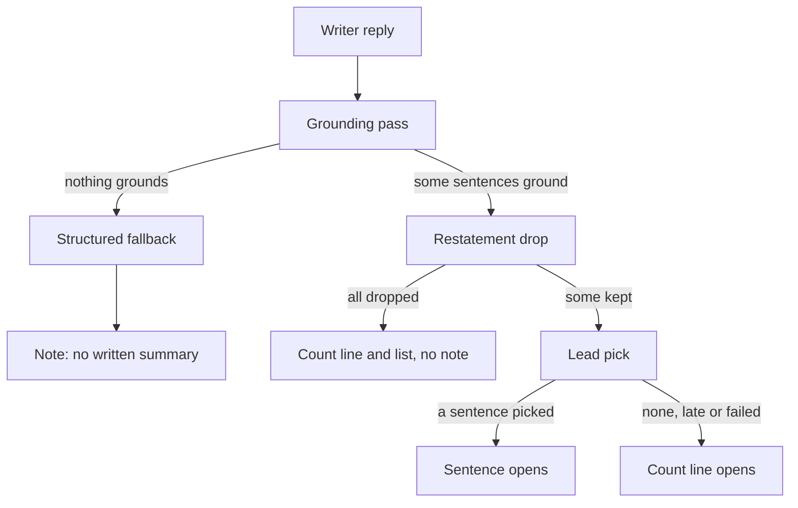

# Diagnosis of cards 128, 130 and 131

Diagnosis only, no fix. Code read on develop at `25235e98` (line numbers are at that commit). Evidence is the code, three earlier reports, one offline probe of the grounding pass and the unit tests that pin the behaviour. No live model or API call was made, so the share of answers taking each path is not measured here; the runs that would measure it are named at the end.

## Table of contents

- [Short answer](#short-answer)
- [How the Write step builds an answer](#how-the-write-step-builds-an-answer)
- [Cause A: the writer is given only the records' names](#cause-a-the-writer-is-given-only-the-records-names)
- [Cause B: a summary dropped as repetition gets no note](#cause-b-a-summary-dropped-as-repetition-gets-no-note)
- [Cause C: the count line opens whenever no written sentence is picked](#cause-c-the-count-line-opens-whenever-no-written-sentence-is-picked)
- [Cause D: the count line pastes record titles as they are stored](#cause-d-the-count-line-pastes-record-titles-as-they-are-stored)
- [Cause E: written sentences that only list several records survive](#cause-e-written-sentences-that-only-list-several-records-survive)
- [Which cause explains which observation](#which-cause-explains-which-observation)
- [Fixes, smallest first](#fixes-smallest-first)
- [What could not be confirmed, and the runs that would](#what-could-not-be-confirmed-and-the-runs-that-would)

## Short answer

| Card | Cause | One shared root? |
|---|---|---|
| 130, no written summary | A, then the answer takes one of two code paths | A is the shared root of 128 and 130 |
| 128, no summary and no note | A, then B: every written sentence was dropped as repetition, and only the other path carries the note | Same root as 130, plus its own code gap |
| 131, the first sentence counts or lists | C (a consequence of A), D (a separate code fault) and E (a separate gap) | Partly shared: C follows from A; D and E are independent |

In words a reader would use: for a question whose answer is a list (orthologs, variants, genes, isolates, papers), the writer is handed only the names on that list. Any sentence it writes either repeats a name, which the app removes because the list below already shows it, or says something more, which the app removes because no record backs it. What is left is the count line and the list.

## How the Write step builds an answer

| Stage | What it does | Where |
|---|---|---|
| Grounding pass | Keeps a sentence only when each cited value is copied whole, or, for a reworded sentence, when the record's own words are quoted and a classifier model approves it | `core/graph.py:10249` to `:10344`; fails closed at `:10292`, `:10330` to `:10336` |
| Structured fallback | When nothing the writer wrote grounds, the code-built listing stands in and the note "no written summary could be checked" is set | `core/graph.py:14801` to `:14822`, note at `:15045` to `:15055`, text at `:10954` to `:10969` |
| Restatement drop | Removes every written sentence that cites one record and adds no word beyond that record's own rendering | `core/graph.py:14899` to `:14904`; rule at `synthesis/answer_layout.py:1196` to `:1224` |
| Lead pick | A classifier reads the question and the first two cited written sentences and may pick one to open; otherwise the count line opens | `core/graph.py:12910` to `:12990`, `harness/decide.py:589` |
| Count line | Code-built "Found N ... records for X" or "I found N ... related to X" | `synthesis/answer_layout.py:1764` to `:1974`; called at `core/graph.py:15430` |

## Cause A: the writer is given only the records' names

What the writer receives:

- One finding per record, from its label field. The only second finding a row can add is a `summary` of 80 characters or more (`synthesis/findings.py:129`, `:133`). An ortholog row's organism, a dbSNP row's gene, a variant's condition and an isolate's resistance genes never reach the writer. Recorded for the organism on 2026-10-16: "the organism field never reaches the writer, the grounding gate or the trust verdict" (`testing/Developer/reports/2026-10-16_card37_38/adversary_B.md:76`); for the dbSNP gene, "Gene never reaches the writer" (`testing/Developer/reports/2026-10-16_card37_38/diagnosis.md:50`).
- The table the reader sees shows more than the writer saw: card 38 slice B put the organism in the table only.

What the writer is told:

- "Do not report what you found ... your job is what they mean for the question" (`synthesis/findings.py:857` to `:863`).
- A short finding, such as a name or a title, must be stated "in full and exactly, in its own sentence" (rule 3, `:877` to `:885`). Only a long finding (an abstract, summary or trial description) may be reworded with a quote (rule 3a, `:886`).
- Plain language extends the reworded form to plain descriptions of records (`:1632` to `:1646`). Researcher allows it only for "an abstract, summary or description" (`:1651` to `:1664`), so a paper title stays under rule 3.

What the checks then do, shown offline with develop's own `run_grounding_pass` and `drop_record_restatements` (probe at `<scratchpad>/probe130.py` and `probe130c.py`, no model call):

| Writer sentence | Result |
|---|---|
| "tumor protein p53 [1]." | Grounds, then dropped as a restatement |
| "TP53 has orthologs in many species, including tumor protein p53 [1]." | Stripped: "many species" has no record behind it |
| "TP53 is conserved across mammals and fish [1][2][3]." | Stripped |
| "An ortholog of TP53 is tumor protein p53 [1]." | Survives, and says nothing a reader wants |
| "The Hdj-2/Hsc70 chaperone pair facilitates early steps in CFTR biogenesis [1]." (the title copied) | Grounds, then dropped as a restatement |
| "One paper reports that the Hdj-2/Hsc70 chaperone pair ... [1]." | Stripped |
| "The papers cover CFTR folding and splicing [1][2]." | Stripped |
| A reworded sentence with the title quoted inside the marker | Sent to the classifier sentence check; survives only if approved within the budget |

So for a list question the answer the reader wants ("TP53 has orthologs in rabbit, medaka and horse"; "these papers cover CFTR folding, splicing and mutations") cannot be written from what the writer is given. This is the 2026-09-21 lesson recorded beside `_EXPLANATORY_FIELDS` ("the fix is ... change the INPUT", `synthesis/findings.py:120` to `:123`), applied to summaries but not to list rows.

## Cause B: a summary dropped as repetition gets no note

- The note is set only when the structured fallback ran (`core/graph.py:15045` to `:15055`). The fallback runs only when nothing the writer wrote grounded (`:14802`).
- When the writer's sentences ground and the restatement drop then removes all of them, the listing still grounds, so the merged answer has claims (`:14910` to `:14946`). The prose is put back only when the listing grounds nothing (`:14984` to `:14989`). The answer is the count line and the list, with no note and the trust outcome "answer" rather than "ask" (`:15042` to `:15043` floors only the fallback).
- This is pinned on purpose: `tests/system_03_search_agent/core/test_write_answer_quality.py:266` to `:292` asserts that a restatement-only reply shows no "no written summary" note and ends "answer" ("restatements are not a grounding failure; the fallback note must not appear"). The comment above the drop says "dropping the restatements no longer empties the page" (`core/graph.py:14895` to `:14897`); the observations below show it does.
- Seen live on develop's own path on 2026-10-16: a TP53 Researcher run whose "writer's sentences grounded and were then all dropped as one record restatements ..., so no fallback note fired and the trust line read 'Based on 58 sources cited' with only the list on screen", while develop's run of the same question took the fallback with the note (`testing/Developer/reports/2026-10-16_card37_38/adversary_B.md:75`; again in `verifier_B.md:38`).

Card 128 is this path. The CFTR Researcher answer carried the note on 2026-10-17 in card 38 slice C's check and lacked it hours later in card 125's (`testing/Developer/reports/2026-10-17_product_check_card125/report.md:120` to `:126`). Neither change touched this code; the writer took the other path. Why Researcher lands here more than Plain language is consistent with cause A's directives (Researcher must copy a title whole, Plain language may reword it with a quote), but it is not confirmed without the writer's reply.

## Cause C: the count line opens whenever no written sentence is picked

- The count line is the default opening. A written sentence opens only when the classifier, asked about the first two cited written sentences, picks one within 1 second (`core/graph.py:12933`, `:12936` to `:12955`, `:12958` to `:12990`; `harness/decide.py:589`).
- With no written sentence left (cause A), there is nothing to pick, so the count line is all the summary has: "Found 54 article records for CFTR, of 1962 available.", "I found 8 conditions related to bronchiolitis" (browser retest row 38).
- When a sentence is picked, the count line still follows it in the same paragraph (`core/graph.py:13818` to `:13824`), which gives "associated with four diseases ... I found 4 conditions related to BRCA1" (browser retest, defects table) and `testing/Developer/reports/2026-10-17_product_check_card125/run1/q001_brca1_plain_1280.txt`.
- Card 110 tried widening the pick beyond two sentences and was closed (`testing/UI_fix_plan.md:58`); this diagnosis does not reopen it.

## Cause D: the count line pastes record titles as they are stored

- In Researcher, up to six records are named inline (`MAX_SUMMARY_NAMES = 6`, `synthesis/answer_layout.py:1613`) by `summary_label`, which returns the stored value (`:1754` to `:1761`) joined with commas and a closing full stop (`:1954` to `:1960`). A paper title ends with its own full stop, so the line reads "BRCA1: An Endocrine and Metabolic Regulator., EXO1 protects ... lesions., ... synthetic lethality.." (`testing/Developer/reports/2026-10-17_product_check_card125/run1/q108_brca1_5y_researcher_1280.txt`).
- The noun is the record type lower-cased (`synthesis/answer_layout.py:1940`, `core/next_step.py:80` to `:88`), so a live PubMed type reads "pubmed records", and a type already ending in "record" reads "variant record records" (card 121).
- This is code alone; no model is involved.

## Cause E: written sentences that only list several records survive

- The restatement drop removes a sentence only when it cites exactly one record (`synthesis/answer_layout.py:1221`). Card 111's rule removes a sentence only when one label repeats (`core/graph.py:13075` to `:13163`). A sentence that copies thirteen different HGVS names, each whole, passes the grounding pass and both rules: "Additional variants retrieved include ..." (browser retest row 7), the variant sentences of queries 79 and 115 (defects table).
- The writer is told not to list (`synthesis/findings.py:918`, `:1660` to `:1664`), but nothing after the writer enforces it for several records.
- The ESBL answer that "opens by listing 20 isolate codes" (row 48) is in Plain language, where the count line names no records (`synthesis/answer_layout.py:1907` to `:1930`), so it is a written sentence, and it opened, so the classifier picked it. Not confirmed: the run's text and decision record were not saved.

## Which cause explains which observation

| Observation | Source | Cause |
|---|---|---|
| TP53 orthologs, no summary, with the note | Retest row 4; `verifier_B.md:116` | A, fallback path |
| TP53 orthologs Researcher, no summary, no note | `adversary_B.md:75` | A, then B |
| CFTR papers Researcher, no summary, no note | Card 125 check, PR-card125-02 | A, then B (path inferred) |
| CFTR papers, no summary, with the note | Card 38 slice C check, PR-card38c-01 | A, fallback path |
| CFTR variants (query 22), MODY genes (query 78), rs334 and rs6025, colistin isolates, query 104 | Retest rows 7, 57, 6, 48, 47; defects table | A; which of the two paths each took was not recorded |
| "I found 8 conditions related to bronchiolitis" opening | Row 38 | C |
| Count line and lead sentence saying the same thing | Defects table, query 1 | C |
| "Regulator., ... lethality..", "pubmed" in lower case | Defects table, query 108 | D |
| "variant record records for rs334 and rs6025" | Defects table | D (card 121) |
| 13 HGVS names in the summary | Row 7; queries 79 and 115 | E |
| 20 isolate codes opening the answer | Row 48 | E, picked as the lead (inferred) |

## Fixes, smallest first

Every fix leaves the grounding pass and the sentence check as they are, and none reads a word of the question in code.

| Fix | Cause | What a person sees | Where | Risk |
|---|---|---|---|---|
| 1. Say so when the summary only repeated the records | B | Every answer with no written summary says why, on both paths | Set a note when the restatement drop leaves no written sentence, beside `core/graph.py:15045`; flip the test at `tests/system_03_search_agent/core/test_write_answer_quality.py:289` | Low, text only. Two owner choices: the note's words (today's "could be checked" is not true on this path), and whether this path should also read "not yet confirmed" like the fallback |
| 2. Count line names titles cleanly | D | "Found 4 papers for BRCA1" with no doubled full stops, and no "pubmed records" | `synthesis/answer_layout.py:1754` to `:1960`: strip a label's closing punctuation before joining, and count paper records instead of naming them inline (their titles are in the list right below); map record types to reader nouns | Low; tests that pin exact count lines change (`tests/system_03_search_agent/synthesis/test_answer_layout.py`) |
| 3. Researcher may describe a paper in its own words | A, papers only | The CFTR papers question in Researcher gets sentences on what the papers cover, as Plain language does | Add the Plain language clause (reword with the title quoted inside the marker) to the Researcher directive, `synthesis/findings.py:1651` to `:1664`. The system instruction, and so the stable prefix, is unchanged | Medium: more sentences go to the sentence check, which costs time inside the 20 second bar; the check fails closed, so the worst case is today's answer |
| 4. Give the writer what the table shows | A, every list question | Orthologs answered by species, rs334 and rs6025 by gene, isolates by resistance gene, variants by condition | Emit the distinguishing table column (organism, gene, condition, resistance genes) as a second finding per row, the way `summary` is (`synthesis/findings.py:129`, `:465` to `:490`) | Medium to high: more findings compete for the 30 prompt slots; a clinical value (significance, condition) changes the answer's risk tier; needs the owner's test queries before and after. This is the root fix for card 130 |
| 5. Do not repeat the count after a picked lead that cites the same records | C | "BRCA1 is associated with four diseases ..." without "I found 4 conditions related to BRCA1" after it | `core/graph.py:13818` to `:13824`: skip the count line when its markers are a subset of the lead's | Low; structural only. Whether the count must always show is the owner's |
| 6. A sentence made only of several record labels does not open the answer | E | No answer opens on a run of codes | Exclude such a sentence from the lead candidates (`core/graph.py:12936`), using card 111's label machinery without its one-label test | Medium: card 110's design says a list of different names can answer "which", so this needs the owner's call before it is built |

Order by what the user feels first: fix 1 and fix 2 are small and remove a dishonest and a broken-looking line today; fix 4 is the one that turns card 130's lists into answers, and fix 3 is its narrow first step for the papers question.

## What could not be confirmed, and the runs that would

Not confirmed without a live run:

- Which path (fallback with note, or restatement drop with no note) each card 130 question takes, and how often.
- That the CFTR Researcher answer in card 125's check took the restatement path rather than another way to an empty summary.
- That the ESBL opening was a written sentence the classifier picked.
- That fix 3 or fix 4 makes sentences survive the sentence check, and at what cost in seconds.

The runs, each through `core/run.py`'s `run_streaming` locally with the web client's settings (`reads_placement=True`), develop's writer, the classifier on, and the 25-cent cap, with a wrapper logging the writer reply, the first grounding pass, the sentence check's candidates and approvals, `restatements_dropped`, `structured_fallback_used` and `done.decisions`, as phase 8.7's diagnosis did (`testing/Developer/reports/2026-10-09_product_check_8.7/diagnosis.md`):

| Run | Questions | Depths | Repeats | What it separates |
|---|---|---|---|---|
| R1 | Query 117 (CFTR papers) | Researcher, Plain language | 5 each | Restatement drop against stripping, per depth (card 128) |
| R2 | Queries 116, 22, 78, 104, "What are rs334 and rs6025?", the colistin isolates question | Both | 3 each | The path each card 130 question takes |
| R3 | Query 33 (ESBL isolates) | Plain language | 3 | Whether the lead pick chose the codes sentence (cause E) |

About 56 runs; at the 0.6 to 3 cents per run recorded in the phase 8.7 diagnosis this is roughly 0.5 to 1.5 dollars. No spend is approved yet, so none was run.
