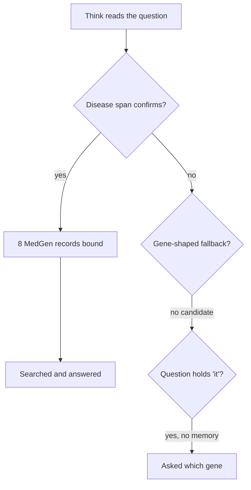

# Diagnosis of cards 145 and 129, 2026-10-22

Why the bronchiolitis question is sometimes asked "which gene, variant or condition do you mean?" (card 145), and why "How many genes are associated with breast cancer?" answers with one record named "Seen by breast cancer nurse" (card 129). Read-only: code on `develop` at `25235e98`, the reports named below, one offline probe of the deterministic rules (no model call, no NCBI call) and two unit test files run locally (21 passed). Nothing here was run live; what a live run must settle is named in its own section.

## Table of contents

- [Summary](#summary)
- [Card 145: the bronchiolitis ask-back](#card-145-the-bronchiolitis-ask-back)
- [Card 129: the breast cancer count](#card-129-the-breast-cancer-count)
- [Do they share a cause](#do-they-share-a-cause)
- [What a live run must settle](#what-a-live-run-must-settle)
- [Owner rules each fix must keep](#owner-rules-each-fix-must-keep)

## Summary

| Card | What the person sees | Cause, in one line | Varies run to run? | Smallest fix a person would notice |
|---|---|---|---|---|
| 145 | Asked "which gene, variant or condition do you mean?" after naming bronchiolitis, about half the time | When the question-reading model's disease span does not confirm in MedGen, a fixed word rule reads the "it" in "how is it usually treated" as pointing back at an earlier turn and asks back | Yes: the variance is in the Think classification's entity list, sampled at the provider's default temperature | On the ask-back path only, read the question a second time before asking, and never ask "which gene" of a question a classifier says names its own subject |
| 129 | "I found 1 record related to breast cancer", the record "Seen by breast cancer nurse", and a note of upper-case names the person never typed | The disease binding rule picks up to 8 MedGen records whose titles contain "breast cancer", by concept id, so a nurse-visit finding is bound and the real breast cancer record is not; the count over 8 records then has no template and the model-written count cites the first one | No in the binding (same shape on 2026-09-25, 09-26, 09-29, 10-18); only which record the count cites varies | Rank MedGen records by their own record type when binding, so a "Finding" such as a nurse visit never stands in for a disease when a disease record matched |

They meet at one seam, Think's disease resolution, but they are two defects: a fix to one does not fix the other. Details in [Do they share a cause](#do-they-share-a-cause).

## Card 145: the bronchiolitis ask-back

### What was observed

- Production check after v0.3.0, `testing/Developer/reports/2026-10-18_browser_retest/report.md`, "Production check": bronchiolitis in Plain language was asked back on develop (1 of 1) and on production (1 of 1, then 2 of 4 more). The 2 answered runs carried 19 citations.
- When it answers, it binds 8 MedGen records ("Acute bronchiolitis", "Bronchiolitis, Viral" and others): `testing/Developer/reports/2026-10-08_product_check/bronch_plain_live_1280.txt`, line 5, "I found 8 conditions related to bronchiolitis".
- The wording asked back is `CLARIFICATION_QUESTION`, `src/system_03_search_agent/core/graph.py:6587`. That rules out the other two ask-backs: card 116's and card 48's "which aspect?" (one to three words only, `graph.py:4266` to `4268`, `_MAX_CLARIFY_TRIGGER_WORDS = 3` at `graph.py:3882`; this question has 11 words) and card 56's organism question (`graph.py:4653`, which would have named an organism).

### The path, step by step

| Step | What the code does | Where |
|---|---|---|
| 1 | The plan-tier model returns `entities`, each tagged gene, disease, organism or other. TASK 4 asks for a disease span "EXACTLY as written" | `graph.py:2681` to `2688`; schema `graph.py:2562` to `2579` |
| 2 | Each disease span is confirmed against MedGen by one ESearch of its content words ANDed as `[title]` clauses, then one ESummary | `resolve_disease_mention_to_curies`, `graph.py:3308`; term built at `graph.py:3374` to `3381` |
| 3 | A disease span that confirms nothing is dropped silently, never filed as unresolved | `graph.py:3535` to `3548` |
| 4 | When nothing resolved, the fallback tries only tokens with a digit or in all capitals. "bronchiolitis" is lower case, so it is never tried | `_gene_shaped_fallback_candidates`, `graph.py:3677` to `3680`; the disease half reuses the same candidates, `graph.py:4510` to `4540` |
| 5 | `_needs_clarification` returns True when nothing resolved, no symbol failed, no remembered entity, and the question holds any word in `_REFERRING_WORDS` ("it", "its", "this", "that", "one" and six more) | `graph.py:6619` to `6646`; word set `graph.py:6516` to `6518` |
| 6 | Think sets the clarifying question, Plan selects no tool, Write streams the question as the answer | `graph.py:4641` to `4652`; Plan's early return `graph.py:6872` to `6895` |

Offline probe of steps 2, 4 and 5 (pure functions, no network), run against this tree:

| Input | Result |
|---|---|
| `_needs_clarification(question, no memory, nothing resolved)` | True |
| The same with one MedGen CURIE resolved | False |
| `_gene_shaped_fallback_candidates(question)` | `[]` |
| MedGen term for the span "bronchiolitis" | `bronchiolitis[title]` |
| MedGen term for the span "bronchiolitis in babies" | `bronchiolitis[title] AND babies[title]` |

### Why it fails about half the time, and where the variance enters

The rule in step 5 is deterministic. It was written for a follow-up such as "What variants cause it?" sent with nothing before it (its docstring, `graph.py:6625` to `6639`; test `tests/system_03_search_agent/core/test_clarification.py:160`). In the bronchiolitis question the "it" points back at bronchiolitis in the same sentence, so the rule only stays silent when step 2 confirmed the disease. Whether step 2 confirms depends on what the model returned in step 1. The variance enters there:

- The Think call sends no `temperature` (`src/system_03_search_agent/harness/harness.py:731` to `742`; no `temperature` anywhere under `src/`), so the entity list is sampled at the provider's default each run.
- Measured on a sibling question: `What are the typical symptoms and risk factors of GERD?` returned `gerd:d` on 5 of 6 runs and no entity on 1 (`testing/Developer/reports/2026-10-09_card20/judge.md`, Think comparison table, row 5). A plain disease name is not extracted every time.

Three readings of step 1 lead to the ask-back, and the code cannot tell them apart today because no Think event for a bronchiolitis ask-back was saved:

| Reading the model may return | What step 2 does | Ask-back? |
|---|---|---|
| No entity at all | Nothing to confirm | Yes |
| `bronchiolitis` tagged `other` (the schema admits it, `graph.py:2579`) | Never attempted | Yes |
| `bronchiolitis in babies` tagged `disease`, "exactly as written" | ANDs `babies[title]`, which a bronchiolitis record title is unlikely to carry, so likely zero hits | Yes, if MedGen matches nothing |
| `bronchiolitis` tagged `disease` | Binds 8 records | No |

A second, smaller source, which cannot be ruled out from the reports: a MedGen transport failure returns `([], 0)` and is not cached (`graph.py:3387` to `3393`, `3404` to `3410`). The production check sent twelve runs at once against each deployment (report, "What it shows"), so an NCBI rate-limit refusal under that load would also land on the ask-back. A success is cached per process (`graph.py:3438`), so once one run confirmed "bronchiolitis", a later failure in the same process points at the model's span, not at NCBI. The order of the four production runs was not recorded.

These are not incompatible hypotheses: every one ends at the same gate in step 5, so a fix at the gate covers all of them. The live run below says which one dominates, which decides whether a stabilising change is also worth making.

### Smallest fix

What the person typing the question wants: an answer about bronchiolitis, or, if the system truly cannot read it, a question that does not ask them for a gene they never had in mind. "A refusal says what to type next": today's ask-back tells a person who named a condition to name a condition.

Fix A, recommended first. Gate the existing ask-back on a second reading:

- When `_needs_clarification` is about to return True on a turn with no session memory, run the Think classification once more and re-run confirmation. Ask back only if the second reading also resolves nothing.
- This is the owner's card 56 call (4), "when the question-reading model names nothing even when asked a second time" (`DECISIONS.md`, 2026-10-17), applied only on the path where the person would otherwise be asked back. The model reads, code verifies through MedGen: no word list, no test question in a prompt.
- Card 56's slice 1 was closed partly because its extra model call "fired on ordinary questions (one topic question took 46 s)" (`testing/UI_fix_plan.md`, card 56 row). Scoped to this gate, it fires only where the answer today is an ask-back, so no question that answers today pays for it.

Fix B, the complement, so a stable outcome does not rest on sampling luck. Before the gene-wording question is asked, a guard-tier classifier decides whether the question names its own subject (card 56 call (5)'s "does this question name its own subject?" check, owner-approved 2026-10-17). When it does and nothing resolved, the question is searched rather than asked back. Plan already handles that case: a plain-English disease with no resolved entity "still falls through to the normal `_PlannedToolCall` branch ... with an empty `target_entities` list" (`graph.py:6730` to `6736`).

What would make the outcome stable, beyond A and B:

- Pinning `temperature` for the Think classification call in `harness.py` would make the entity list near-repeatable per model, but could lock in a wrong reading (`bronchiolitis in babies`) on every run. Decide only after the live run.
- If the live run shows the compound span is the common failure, a general instruction in TASK 4 ("name the condition itself, without who has it") is the model-side fix. It must stay general; it must never quote bronchiolitis or babies.

Risks and what else each fix could change:

| Fix | Risk | What else it changes |
|---|---|---|
| A | About 2 s more on the ask-back path only; two failed readings still ask back, so it lowers the rate rather than ending it (if the two readings fail independently at one in two, to about one in four) | Every first-turn question with "it", "this", "that" or "one" whose subject did not resolve, for example a lower-case disease name or a rare condition |
| B | A truly dangling first message ("What variants cause it?") misread as naming its subject would be searched instead of asked; test `test_clarification.py:160` guards that case and must stay green | Same set as A; adds one decision point to `harness/decide.py` and its prompt file |
| Temperature | A deterministic wrong reading | Every Think classification, so every question; needs the golden and test-queries gates |

Test gap: no test covers a first question that names its own subject in plain English, carries a referring word, and whose span does not confirm. `test_clarification.py:204` and `:213` cover a resolving gene and a question with no referring word.

## Card 129: the breast cancer count

### What was observed

- 2026-10-18, browser retest row 28 and the defects table: "I found 1 record related to breast cancer", sources "Record" [1] and "Seen by breast cancer nurse" [2], a note listing "Paraneoplastic SPS is associated with breast cancer and other malignancies, BREAST CANCER, INVASIVE, SUSCEPTIBILITY TO, Familial BREAST CANCER susceptibility 2, ..." (`screens/L_q87_breast_cancer_genes_one_nurse_record.jpg`).
- 2026-09-29: "Found 1 derived record for breast cancer: MedGen:C1320450", the same note, seven names (`testing/Developer/reports/2026-09-29_retest/runner_B/q87a_breast.txt`).
- 2026-09-25: "Derived MedGen:C1320450, n: 0" on pass 1; pass 2 named MedGen:C2675521 (`testing/Developer/reports/2026-09-25_product_review_8.1/report.md`, PR-8.1-05).
- The model reads the question the same way every time: `breast cancer:d` and `aggregate` on 6 of 6 runs (`testing/Developer/reports/2026-10-09_card20/judge.md`, table row 10).
- C1320450 is "Seen by breast cancer nurse", MedGen semantic type "Finding"; breast cancer itself is C0006142, titled "Malignant tumor of breast", type "Neoplastic Process" (`graph.py:8036` to `8042`; fixture title at `tests/system_03_search_agent/core/test_write_answers_sooner.py:516`).

### The path, step by step

| Step | What the code does | Result for this question | Where |
|---|---|---|---|
| 1 | Think extracts `breast cancer` as a disease | Stable, 6 of 6 | judge table row 10 |
| 2 | ESearch `breast[title] AND cancer[title]` on MedGen, 20 hits read; `[title]` matches titles and synonyms | Offline probe confirms the term | `graph.py:3374` to `3398` |
| 3 | Rule 1: bind records whose title equals "breast cancer" | None: C0006142's title is "Malignant tumor of breast" | `graph.py:3425` to `3427` |
| 4 | Rule 2: up to 8 records, first those whose TITLE contains the phrase, sorted by concept id, then synonym-only matches | Eight phrase-in-title records fill the cap; C0006142 matches only by synonym, so it is cut. C1320450 sorts first | `graph.py:3428` to `3437`; cap `graph.py:3260` |
| 5 | Plan's template choice: Disease anchor, shape "genes", asks "how many", 8 anchors | No template: `if wants_count and len(param_names) > 1: return None`, so the model writes the query | `src/system_03_search_agent/tools/cypher_templates.py:908` to `912`; offline probe returns None for 8 anchors and `disease_genes_one_count` for 1 |
| 6 | A count is cited only when the query bound exactly one entity | The model-written query bound one of the 8 (C1320450 on 09-25 and 09-29, C2675521 once), and the count came back 0 | `src/system_03_search_agent/tools/cypher_query.py:1573` to `1577`; PR-8.1-05 |
| 7 | With two or more target entities, any without a surviving citation is named in a note as "entities named in the question", by MedGen title | The other 7 bound titles, in MedGen's own upper case | `graph.py:15076` to `15106`; note text `graph.py:10216` to `10226` |

So the "1 record" is the count row, and the person never sees a number of genes. Every statement is honestly cited to a real record; the record is the wrong one. That is the owner's worst case: "A confident wrong record is worse than a missing one."

Where variance enters: only in step 6, which of the eight anchors the model-written query uses. Steps 2 to 5 are deterministic for a given MedGen index.

### Smallest fix

What the person typing the question wants: a number of genes linked to breast cancer, cited to the breast cancer record, or an honest "the graph lists none".

Fix C, recommended first, the smallest a person would notice. When binding a disease mention, rank the candidate records by MedGen's own record type before concept id:

- Records whose `semantictype` is in `_MEDGEN_DISEASE_SEMANTIC_TYPES` (`graph.py:8053`) come first; a "Finding" or "Sign or Symptom" record binds only when no disease-typed record matched.
- The ESummary already returns `semantictype` (`src/system_03_search_agent/tools/ncbi_eutils_actions.py:878`), wrapped as `{"value": ...}` (`graph.py:7959` to `7960`), so it costs no extra call.
- It reads a field of the record, not a word list, so code only verifies.
- Result for the person: "Seen by breast cancer nurse" no longer appears for any breast cancer question, count or not.

Fix D, the one that makes the answer a number. A count over several Disease records takes the gene-list template instead of the model path:

- In `select_template`, let a "how many genes" question with several Disease anchors take `_disease_genes_template` (`cypher_templates.py:549`, already built for several anchors and folding each gene's linked records), and state the count of distinct genes it returns, with "at least" when the row cap cut the list.
- Each gene is then cited to its own record, so no single derived row needs one anchor's citation.

Risks and what else each fix could change:

| Fix | Risk | What else it changes |
|---|---|---|
| C | Some real phenotypes are typed "Finding" in MedGen (Tall stature, Arachnodactyly; "Seizure" is "Sign or Symptom", `graph.py:8036` to `8040`). Ranking, not excluding, keeps them bindable when nothing disease-typed matched | Every disease binding, including bronchiolitis's 8 records and MODY's; the cap may now admit a synonym-tier disease record (whether C0006142 is in the first 20 hits is not confirmed) |
| D | A count drawn from a capped list must say "at least"; the count line already carries an "out of N available" form (`src/system_03_search_agent/synthesis/answer_layout.py:1882` to `1886`) | Every "how many genes" question over several disease records; golden G-034 is this question |
| Note wording | Separate and small: the note says "entities named in the question" when one mention expanded into several records. Leave for after C and D, which remove most of its content | `graph.py:10216` to `10226` |

Not confirmed without a live NCBI call: which eight records MedGen returns today for `breast[title] AND cancer[title]`, each one's semantic type, and whether C0006142 sits in the first 20 hits. Fix C alone cannot bind C0006142 if it is outside those 20. A follow-on candidate, to measure first: also treat a record as an exact match when one of its synonyms equals the mention, if ESummary carries synonyms.

## Do they share a cause

They share a seam and not a defect.

| Question | Card 145 | Card 129 |
|---|---|---|
| Step where it goes wrong | Think's resolution, then the ask-back gate | Think's resolution, then Plan's template choice |
| Does the model misread the question? | Sometimes: its disease span varies or is missing | No: `breast cancer:d`, 6 of 6 |
| Does the MedGen rule misbind? | No: "bronchiolitis" binds 8 sensible records when it is asked | Yes: title containment by concept id binds a nurse-visit finding and cuts the real record |
| Deterministic or variable | Variable (model sampling; possibly NCBI under load) | Deterministic binding; only the cited anchor varies |

The common thread is that both treat the outcome of one code rule as a fact about what the person said:

- In card 145, "nothing confirmed in MedGen" is read as "the person named nothing".
- In card 129, "these 8 titles contain the words" is read as "the person named these 8 entities", and the note says so.

Fix C changes the binding that bronchiolitis also uses (all its records are expected to be disease-typed, so its 8 should not change; confirm in the live run). Fix A or B does not touch card 129's path, which never reaches the ask-back. Build them as two pull requests, as `DECISIONS.md` 2026-10-22 already plans. Card 145's fix overlaps card 56's open design (the second reading and the own-subject check); build it so card 56 reuses it rather than adding a second copy.

## What a live run must settle

No spend is approved, so these were not run. Each is named so it can be run as written.

| Run | What it settles | Spend |
|---|---|---|
| Think classification alone, 20 times, on `What causes bronchiolitis in babies, and how is it usually treated?`, recording `entities` each time (the card 20 judge's harness did this for 20 questions) | Which of the three readings causes the ask-back, and how often | 20 plan-tier calls |
| `resolve_disease_mention_to_curies` on each distinct span from that run, with a cold cache | Whether "bronchiolitis in babies" confirms nothing, as the probe's term suggests | NCBI only, no model |
| Develop or production logs for "MedGen disease search failed" around the 2026-10-18 production check | Whether NCBI failures under twelve parallel runs contributed | None |
| MedGen ESearch `breast[title] AND cancer[title]`, retmax 20, then ESummary of the hits | The eight bound records, their semantic types, and whether C0006142 is reachable by Fix C | NCBI only, no model |
| After either fix: five or more full live runs of each question on develop, the owner's standing proof for an answer fix | That bronchiolitis answers 5 of 5 and the breast cancer answer names no nurse record | Full runs |

## Owner rules each fix must keep

- No hardcoded decisions: Fix A re-asks the model and verifies through MedGen; Fix B is a classifier decision; Fix C reads the record's own type; Fix D is a template route keyed on what Think already resolved. None quotes a test question in a prompt and none adds a word list.
- A confident wrong record is worse than a missing one: Fix C exists for this rule; Fix B must never bind a remembered entity in place of a subject the question named (card 56 call (2)).
- A refusal says what to type next: if an ask-back remains after Fix A and B, its wording should name what was missing, never a gene, for a person who named a condition.
- No degradation on any surface, every answer within 20 s: Fix A adds about 2 s only on a path that answers nothing today.
