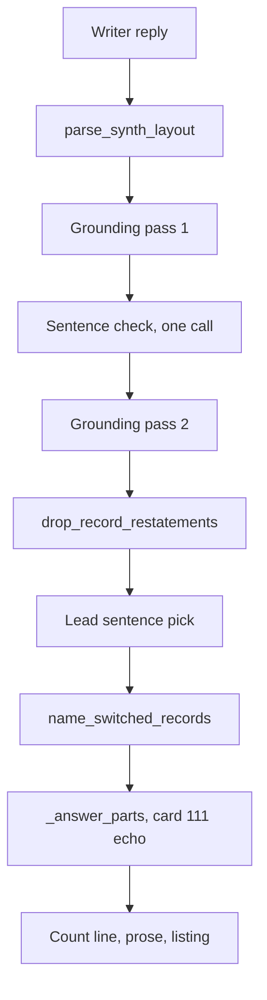

# Card 147 diagnosis: a summary that opens mid-thought

Read-only diagnosis, 2026-10-29. No source file was changed and nothing was spent: no live model call, no live API. The defect, as a person sees it: the written summary under the count line opens on a sentence that points back at one they never see.

- PR-notes-04, query 117 in Plain language at 1280: "I found 54 published papers related to CFTR, out of 1962 available." then "Another finds that a cellular energy-sensing protein can turn CFTR off."
- PR-notes-13, query 117 in Researcher at 390: "Found 54 papers for CFTR, of 1962 available." then "Sodium 4-phenylbutyrate downregulation of Hsc70 ... are also covered."

Query 117 is "Which papers in the graph mention the CFTR gene, and what do they cover?" (`testing/Test_queries_and_workflows.md`, section 117).

## Table of contents

- [Short answer](#short-answer)
- [What the evidence holds](#what-the-evidence-holds)
- [The path from the writer to the screen](#the-path-from-the-writer-to-the-screen)
- [The cause](#the-cause)
- [Reproduction](#reproduction)
- [Every mechanism that can leave a dangling opener](#every-mechanism-that-can-leave-a-dangling-opener)
- [Which mechanism produced each observed case](#which-mechanism-produced-each-observed-case)
- [Recommended fix](#recommended-fix)
- [Alternatives considered](#alternatives-considered)
- [Verdict](#verdict)

## Short answer

The report's guess is confirmed in kind and widened. A writer sentence is removed after writing, and the next sentence, which leans on it, still shows. Two different removal stages do it, and neither asks whether the sentence after the removed one still makes sense:

- The grounding pass (`src/system_03_search_agent/synthesis/grounding.py`) drops whole sentences for many reasons, the sentence check's refusal among them. Its only guard for the next sentence is the bare pronoun rule ("They", "It", "These are"). The list that used to guard "Another", "A third", "also" and the rest was removed on 2026-09-24 (commit a565fd71, item 12.16 part 4), on the stated reason that the restatement drop catches "Another is titled X" by structure. It does not catch "Another finds that ...": a reworded sentence carries a quote and is never a restatement.
- The restatement drop (`answer_layout.drop_record_restatements`) runs after the grounding pass and removes sentences with no check at all on what follows them, not even the bare pronoun rule.

Cause clear: yes, at the level of mechanism, reproduced offline three ways. Which removal produced each observed case cannot be proven from the saved evidence, but the fix below does not depend on it. Fix small: no. The fix that keeps the owner's rules is a new classifier decision, about 90 to 110 lines of source, and its wording needs live runs to prove.

## What the evidence holds

The evidence folder is `testing/Developer/reports/2026-10-22_product_check_notes_papers/`.

| File | What it holds | Useful for card 147 |
|------|---------------|---------------------|
| `report.md` | Findings PR-notes-04 and PR-notes-13 | The symptom, word for word |
| `c134_q117_plain_1280.txt` | The page text of the Plain language run | Full shown summary |
| `c134_q117_researcher_390.txt` | The page text of the Researcher run at 390 | Full shown summary |
| `c134_q117_*.json` | Timings, notes, meta line and page text | No streamed events, no trace id, no writer reply |

So the writer's reply is not in the evidence. Two facts the page text does give:

- In both runs record 1, "The Hdj-2/Hsc70 chaperone pair facilitates early steps in CFTR biogenesis.", is cited only by the count line. No shown summary sentence cites it. A first summary sentence about it is the most likely missing sentence in both.
- The Researcher summary's first paragraph has no heading while the next two do, which fits a first paragraph that lost its opening sentence; it proves nothing alone.

## The path from the writer to the screen

| Stage | Where | Removes sentences | Guards the next sentence |
|-------|-------|-------------------|--------------------------|
| Grounding pass, twice | `synthesis/grounding.py`, `run_grounding_pass`, line 1425 | Yes, whole sentences, see the mechanism table | Bare pronoun only, line 1856, through `previous_survived` (line 1491) |
| Sentence check | `synthesis/sentence_check.py`, `check_reworded_sentences`; called from `core/graph.py` `_ground_with_sentence_check`, line 10284 | Indirectly: an item it does not approve is dropped by pass 2 | No |
| Restatement drop | `synthesis/answer_layout.py`, `drop_record_restatements`, line 1257; called at `core/graph.py` line 15076 | Yes, a one-record sentence with no quote whose words the listing row already shows | No |
| Lead pick | `core/graph.py`, `_lead_sentence_choice`, line 13014 | No, it moves one sentence ahead of the count line | Its "neither" criterion already refuses a sentence that "needs an earlier sentence to make sense" (`harness/decide.py`, line 611) |
| Card 17 lead-ins | `answer_layout.name_switched_records` | No, adds a prefix | Not its job |
| Card 111 echo | `core/graph.py`, `_prose_echo_positions`, used at line 14014 | Yes, a sentence that only repeats one title cited to two records | No |

## The cause

Three facts in the code together produce the defect.

1. The grounding pass guards a following sentence only by its first word, and only for pronouns. `_opens_on_bare_pronoun` (`grounding.py`, line 2207) knows "they", "it", and "these", "those", "this" before a linking verb. A sentence opening "Another", "One is", "A further", or carrying "also" or "additionally" passes whenever it grounds on its own.
2. That narrowness was deliberate. Item 12.12 (2026-09-23) had `_CONTINUATION_OPENERS` ("another ", "a second ", "the other ", "also " and eight more). Item 12.16 part 4 removed it on 2026-09-24 under the owner's "Structure, not words" (`DECISIONS.md`, rows of 2026-09-24), with this reasoning in the commit: "The 'Another ...' list goes, since the restatement rule drops that sentence by structure." That holds for "Another is titled X [6]." and is pinned by `test_a_list_continuation_goes_as_a_restatement_not_by_its_first_word`. It does not hold for a reworded sentence: `drop_record_restatements` never drops a sentence that carries a quote (`answer_layout.py`, line 1306), and since items 12.9 and 12.10 almost every Plain language sentence is reworded with a quote.
3. The restatement drop removes sentences after the grounding pass has already decided `previous_survived` for each sentence, and it never looks at the sentence after the one it removes. So even the accepted bare pronoun rule is bypassed there.

The writer is not told that any sentence may be deleted and that each must stand alone (`synthesis/findings.py`, `SYNTH_SYSTEM_INSTRUCTION`, line 849), so it writes "One ... Another ..." chains and "also covered" lists freely.

## Reproduction

Pure functions only, with the sentence check simulated the way the second grounding pass reads it (`verified_syntheses`). Fixture: three CFTR papers, each with its title and abstract as findings on one page, as PubMed records arrive. The scripts sit in the session scratchpad and are not committed.

| Case | Writer text, in short | What was removed, and by what | Shown |
|------|----------------------|-------------------------------|-------|
| A, Plain path | "One paper finds that a helper protein pair guides how CFTR first takes shape [quote]. Another finds that a cellular energy-sensing protein can turn CFTR off [quote]." | Sentence 1, the check did not approve it | "Another finds that a cellular energy-sensing protein can turn CFTR off [1]." |
| A2, Plain path | Same, sentence 1 reworded with no word of its paper's title, both approved | Sentence 1, by the record switch rule (item 12.16 part 4, line 1860) | "Another finds that ... [1]." |
| A', control | Same as A with "It shows that" in place of "Another finds that" | Sentence 1, the check | Nothing: the bare pronoun rule held, as designed |
| B, Researcher path | Record 1's title copied whole [1], then "Sodium 4-phenylbutyrate downregulation of Hsc70 ... are also covered [quote]." | Sentence 1, by the restatement drop | "Sodium 4-phenylbutyrate downregulation of Hsc70 ... are also covered [1]." |
| B2, Researcher path | Record 1's title copied whole [1], then "It shows that the Hdj-2/Hsc70 pair helps CFTR fold early [quote]." | Sentence 1, by the restatement drop | "It shows that ... [1].": the restatement drop bypasses even the bare pronoun rule |

Case B reproduces PR-notes-13's opening word for word apart from the record's own spelling of DeltaF508. The existing pinned test passed when run (`test_quote_anchored_synthesis.py -k continuation`, 1 passed): the assumption it pins is true for "Another is titled" and false for the reworded form.

## Every mechanism that can leave a dangling opener

| # | Mechanism | Where | Guard today |
|---|-----------|-------|-------------|
| 1 | The sentence check does not approve a reworded sentence: a no, a timeout, an unreadable reply, too little budget (under 4 s, `core/graph.py` line 10280), the cost cap, or an item beyond `MAX_CANDIDATES = 30` or over its length cap | `sentence_check.py`, then pass 2 | Bare pronoun only |
| 2 | An exact check fails: quote not in the record, a number not in the quote, a negation mismatch | `grounding.exact_synthesis_checks_pass` | Bare pronoun only |
| 3 | An unmarked sentence that asserts something, or a marker naming a finding the call was not given | `run_grounding_pass`, the unmarked and step 2 branches | Bare pronoun only |
| 4 | A clause stripped from the middle (T-6.2-15) or a copied cut held back (card 101, round 5) drops the whole sentence | lines 1791 and 1806 | Bare pronoun only |
| 5 | Code rules that drop a surviving sentence: unbalanced brackets, a record fragment opener, a bare pronoun after a removed sentence (so one pronoun drop can expose the next sentence), and the record switch rule | lines 1850 to 1866 | Bare pronoun only |
| 6 | The restatement drop removes a copied title or value sentence | `answer_layout.drop_record_restatements` | None |
| 7 | Card 111 removes a sentence that only repeats one title cited to two records | `core/graph.py`, `_prose_echo_positions` | None; rare, since such a sentence is seldom what a later one leans on |
| 8 | The lead pick moves sentence 2 ahead of the count line, so sentence 3 now follows sentence 1 | `_answer_parts`, line 13984 onward | None; rare, and the reader can still see sentence 2 above |
| 9 | The writer itself opens with a back-reference, with nothing removed | The writer's reply | None; unlikely, not excludable without the reply |

A related shape that is not this card: card 107's main case is half a sentence, the start of a sentence kept when a reworded clause at its end is refused (the end strip in `run_grounding_pass`). Card 107's row also lists PR-19-06, "One is double-strand break repair ..." with nothing saying what "one" is. That second example is this card's mechanism, a whole earlier sentence removed, and the fix below covers it.

## Which mechanism produced each observed case

| Case | Most likely | Confidence | Why |
|------|-------------|------------|-----|
| PR-notes-04, Plain | A drop inside the grounding pass (mechanisms 1, 2 or 5) of a reworded first sentence about record 1 | Medium that it is the grounding pass; low on which rule inside it | Plain language sentences are reworded with quotes, so the restatement drop cannot remove them; "Another finds that ..." is itself reworded and survived the check and the record switch rule (it names "protein" from its title); the pair "One ... Another ..." is the writer's usual shape |
| PR-notes-13, Researcher | The restatement drop of a first sentence copying record 1's title (mechanism 6), or a grounding pass drop as above | Medium-low between the two | "X are also covered", "are additionally reported", "Additional topics include" is a title-listing style, and a Researcher writer copying a title produces exactly case B; but a reworded first sentence dropped by the check fits the screen equally well |

Neither can be proven without the writer's reply or the trace, and the 2026-10-22 capture holds neither. The fix below closes both.

## Recommended fix

One fix: a back-reference veto, decided by the classifier, triggered by structure, removing only.

What the person sees after the fix, in their words: "A summary never starts or continues with a sentence that points back at something I cannot see. If the sentence it leaned on was taken out, that one is taken out too, and the paper it cited is still in the list below."

How it works:

- Code finds the gap, exactly and with no word list. After the restatement drop, a shown writer sentence is a candidate when the writer sentence just before it is not shown: its `sentence_origins` value is above 0 and that value minus 1 is not among the shown origins. This is the same structural signal the bare pronoun rule already uses (`previous_survived`), read after every removal instead of inside the grounding pass only.
- The classifier decides the language question for each candidate, through the existing seam `_decide_point` with a new `_DecisionSpec`, as the lead pick does. State: the text the reader sees just before it (the previous shown sentence, or a line saying only a count of records comes before it) and the sentence, markers removed. Options: "stands_alone" and "leans_back". Criteria in neutral words, no phrase from any test answer.
- The sentence stays only on a usable "stands_alone" pick. "leans_back", no pick, a late pick, the cost cap, or guard mode with no classifier all drop it, the same fail-closed rule every check here follows. Candidates are asked at once, in parallel, at most four, and only when a gap exists.
- Removal reuses the restatement drop's renumbering: split `drop_record_restatements` into a shared `drop_sentences(grounding, positions)` so citation numbers stay dense. Every record a dropped sentence cited stays cited by its listing row.

Why this and not a word list: it can only remove a sentence the grounding pass already accepted, so it never widens what a model may approve. That answers the 2026-09-24 worry about widening the model's bounded exception, while keeping "decisions go to a classifier model, code only verifies".

Files it touches:

| File | Change | Rough size |
|------|--------|------------|
| `src/system_03_search_agent/harness/decide.py` | Point name, options, instructions, criteria, state builder, beside the lead sentence block | 35 lines |
| `src/system_03_search_agent/core/graph.py` | Gap finder, the parallel decision, the call after line 15076 and before the lead pick | 50 lines |
| `src/system_03_search_agent/synthesis/answer_layout.py` | `drop_sentences` split out of `drop_record_restatements` | 15 lines net |

Pitfalls the builder must handle:

- Card 128's note. `all_sentences_were_restatements` (`core/graph.py`, line 15084) is computed after the restatement drop. If the veto then empties the prose, that note would wrongly say every sentence repeated a record. Compute the flag before the veto, or exclude veto removals, and show card 139's "no written summary could be checked" note when the veto empties the summary.
- Card 111 runs later, inside `_answer_parts`, so a gap it creates is not seen. Rare; state it as a residual.
- The lead pick must run after the veto, so a vetoed sentence is never offered to open the answer.

Tests that prove it, all offline:

- `tests/system_03_search_agent/synthesis/test_answer_layout.py`: `drop_sentences` keeps numbering dense and keeps every claim's record.
- A new `tests/system_03_search_agent/core/test_back_reference_veto.py`: cases A, A2, B and B2 above as fixtures; the gap finder flags exactly the sentence after each removal and nothing in an answer with no removal; with `_decide_point` stubbed, "leans_back" drops, "stands_alone" keeps, and a timeout, an exception or guard mode drop; the card 128 note does not fire on a veto removal; the lead pick never sees a vetoed sentence.
- `tests/system_03_search_agent/harness/test_decide.py`: the new options, criteria and state are fixed text, bounded, and carry no question or answer text.
- Live, before it ships: query 117 in both depths five or more times, and the classifier's picks read by hand, per the owner's rule that an answer fix is proven by repeated live runs. This step spends money.

Card 107's territory: it does not touch the end strip inside a sentence, which is card 107's main case. It does fix card 107's second example (PR-19-06), so card 107's row should be narrowed when this lands.

## Alternatives considered

| Option | Size | What the person gets | Why not the recommendation |
|--------|------|----------------------|-----------------------------|
| Put back a word list of back-reference openers ("another", "also", "additionally", "one is" ...), applied after every removal | About 25 lines | Fixes both observed cases at no speed cost | It is a hardcoded decision, not a verification: whether a sentence leans back is a judgment about meaning, and a list catches only the phrasings someone listed ("Both", "The other", "Similarly", "In contrast" go through). It would reverse the owner's 2026-09-24 decision that removed exactly this list, and card 110's attempt was closed for the same reason |
| Structural gap rule: never show a sentence whose writer predecessor was removed | About 25 lines, no model call | Never a dangling sentence, at once | It drops every sentence after a removal, including the many that stand alone, at a rate nobody has measured; that risks the owner's no-degradation rule. Worth a replay over saved writer replies before anyone chooses it |
| Tell the writer every sentence must stand alone, since code may delete any | About 3 lines of instruction | Fewer dangling sentences | Prevention, not a guarantee; changes every answer and the stable prompt prefix, and can only be proven live |
| Re-apply the bare pronoun rule after the restatement drop | About 10 lines | Closes case B2 only | Leaves both observed cases open |

## Verdict

- Cause clear: yes. A writer sentence is removed by the grounding pass or by the restatement drop, and nothing after the removal asks whether the next sentence still makes sense; the "Another" list that did was removed on 2026-09-24 on an assumption that holds only for copied sentences. Reproduced offline for both removal stages.
- Fix small: no. The fix that keeps the owner's rules is a new classifier decision of about 90 to 110 source lines over three files plus tests, it adds up to about a second on answers with a gap, and its wording needs five or more live runs, which is spend. The two small fixes are a word list the owner has already ruled out, and a structural rule whose cost to good sentences is unmeasured.
